# Huginn — Technical Design

This document describes how huginn is built, from the source in `src/`. It is
the implementation counterpart to [`SPEC.md`](./SPEC.md) and the decisions are
rationalized in [`ADR.md`](./ADR.md).

## 1. Runtime and dependencies

- **Runtime**: [Bun](https://bun.sh). The `bin` entry `huginn` → `dist/cli.js`,
  produced by `bun build src/cli.ts --target=bun --outdir=dist --minify`.
- **Dependencies actually imported in `src/`**:
  - `@opencode-ai/sdk` — typed HTTP client for the opencode server.
  - `@dahch/muninn` — the memory engine, extracted to its own repository
    (<https://github.com/dahch/muninn>). It supplies the SQLite/FTS5 store, the AST
    symbol graph, the MCP server and the TypeScript contract verifier imported by
    `src/engine/phases.ts`, `src/engine/liveMode.ts`, `src/engine/cycle.ts`,
    `src/commands/memory.ts`, `src/commands/check.ts` and `src/commands/doctor.ts`.
    `better-sqlite3`, `typescript` and `@modelcontextprotocol/sdk` are its
    dependencies, not huginn's.
  - `ink` + `react` — the TUI dashboard.
  - `zod` — `HarnessState` schema validation.
  - `chalk` — ANSI colors in the banner (`src/banner.ts`), headless frontend
    (`src/headless.ts`), CLI output (`src/cli.ts`), plan mode
    (`src/engine/planMode.ts`), shared formatting (`src/format.ts`), and the
    update reminder (`src/update.ts`).
- `react-devtools-core` is declared in `package.json` but not imported
  anywhere in `src/` (declared, unused — do not rely on it).
- **External executables**: `opencode` (spawned as a local server), `git`
  (spawned for diffs and module inference). Nothing else.

## 2. Module map

> `src/muninn/` and `src/contracts/` moved to
> [`@dahch/muninn`](https://github.com/dahch/muninn); the map below still lists them
> where they used to live. Everything else is unchanged.

```
src/
├── cli.ts                  entry point; arg parsing (run/live/plan/install/setup/doctor/memory/mcp/check/config), git bootstrap gate, live-session resume flags, banner, lifecycle wiring
├── agents/
│   └── integrator.ts       AGENT_REGISTRY (13 provisioning targets) + RuntimeId (5 runtimes) + setup(): Muninn MCP registration, per-target rules injection, and the installed × registered provisioning matrix (REQ-15/REQ-38)
├── commands/
│   ├── check.ts            CLI commands: handleCheckCommand (verify TypeScript contracts), printCheckUsage
│   ├── config.ts           CLI commands: handleConfigCommand (show/set thinker+executor), printConfigUsage
│   ├── doctor.ts           CLI commands: runDoctorChecks, handleDoctorCommand (environment/Muninn diagnostics)
│   ├── init.ts             CLI commands: handleInitCommand (onboarding wizard incl. the runtime model picker), printInitUsage
│   ├── install.ts          CLI commands: handleInstallCommand (compatibility no-op — prompts are built in)
│   ├── memory.ts           CLI commands: handleMemoryCommand (init, search, sync, index), handleMcpCommand (run), usage formatters
│   └── setup.ts            CLI commands: handleSetupCommand (run the universal agent integrator)
├── config.ts               RunConfig; UserConfig schema, model resolution + source attribution, atomic symlink-safe config persistence
├── contracts/
│   ├── compiler.ts         TypeScript Compiler API contract verification, pre-emit diagnostics, visual error snippets
│   └── index.ts            re-exports verifyTypeScriptContracts, formatDiagnosticsReport, TypeValidator, types
├── banner.ts               ASCII banner + path shortening (prints the shared HUGINN wordmark)
├── brand.ts                shared ASCII brand assets: HUGINN wordmark + raven mark + the two-ravens idle mark, artWidth (REQ-29 / ADR-29, REQ-51)
├── format.ts               shared formatting: durations, verdict badges/icons/colors (delegates the glyph to the shared table)
├── headless.ts             stdout frontend; stdin decision answering; runLiveHeadless
├── update.ts               background npm version check (cache + semver compare + reminder)
├── engine/
│   ├── agent/
│   │   ├── types.ts            IAgentRuntime (incl. sessionHistory), IAgentSession, ModelInfo, ModelCatalog, McpStatusReport contracts
│   │   ├── registry.ts         Agent factories, AGENT_BINARIES, PATH auto-detection, resolution precedence, SUBPROCESS_PERMISSION_ARGS, subprocessPermissionMessage
│   │   ├── modelCatalog.ts     discoverModelCatalog: the shared catalog lookup + reason used by the picker and the init wizard
│   │   ├── mcpStatus.ts        fetchMcpStatusWithTimeout (bounded `Promise.race`, 60 s listing cache) + attributed, `undefined`-safe formatMcpBadge (REQ-30/REQ-32)
│   │   ├── index.ts            barrel export for runtime subsystem
│   │   ├── genericTargets.ts  GENERIC_TARGET_SPECS: binary, argv, prompt channel, model flag and permission switch for every CLI-only target (M4b)
│   │   ├── port.ts            RuntimeId/RuntimeCapabilities/RuntimePort: the driver-neutral contract (M4b split)
│   │   ├── legacy-bridge.ts   toRuntimePort / toLegacyRuntime: adapters ⇄ port without changing behaviour
│   │   └── adapters/
│   │       ├── opencode.ts     OpencodeRuntimeAdapter (wraps opencode serve daemon + SDK); connected-provider discovery + `opencode models` fallback; sessionHistory = true
│   │       ├── claude.ts       ClaudeRuntimeAdapter (Claude Code CLI / stdio)
│   │       ├── codex.ts        CodexRuntimeAdapter (OpenAI Codex CLI) + `codex mcp list --json` parser
│   │       ├── pi.ts           PiRuntimeAdapter: `-p` + stdin, `--model`, `pi --list-models`, assumed `--approve`
│   │       ├── modelList.ts    runModelListCommand: bounded, sanitized spawn used by every listing CLI (REQ-27)
│   │       ├── mcpList.ts      shared `mcp list` parsers (opencode/claude/codex formats) + listMcpServersViaCommand (REQ-32)
│   │       ├── generic.ts      GenericSubprocessRuntimeAdapter & GenericSubprocessSession (safe stdio, native model flags, auto-approval args, fallback binaries, sessionHistory = false)
│   │       └── index.ts        re-exports the remaining adapters
│   ├── cycle.ts            CycleEngine: pipeline-as-data (per profile, `readOnly` flag), retry/fix/escalate loop, structural verdicts, state machine
│   ├── phases.ts           the 8 phase functions + 3 fix functions; the single prompt seam; huginn-orchestrated VALIDATE_STEP; read-only tree guard
│   ├── steps/              huginn-owned step instructions (REQ-40): instructions.ts (embedded roles/tasks), prompts.ts (per-step composers), context.ts (bounded reads, git capture, untrusted embedding, verdict contracts), types.ts (StepContext)
│   ├── gitRepo.ts          ensureGitRepository: `git init -b main` + `.gitignore` + identity + bootstrap commit (REQ-39)
│   ├── gate.ts             verdict parsers, JSON judge, fail-closed logic
│   ├── profiles.ts         PROFILES: the named pipelines (huginn Cycle + sdd/odd/rdd/strict-tdd) over the phase vocabulary (REQ-36)
│   ├── receipts.ts         frozen iteration evidence under .huginn/receipts/ + treeHash (used by the read-only guard) for rdd/strict-tdd (REQ-36)
│   ├── questionBlock.ts    agent-agnostic `<<<HUGINN_QUESTION>>>` block parser + answer formatter (REQ-37)
│   ├── decisionBroker.ts   FIFO queue of pending human/permission decisions
│   ├── permissions.ts      opencode event subscription: permission handling + stream forwarding
│   ├── planMode.ts         `huginn plan`: drafts spec/adr/plan via the thinker; exported prompt
│   │                       builders + draft-format contract reused by live mode
│   ├── liveMode.ts         LiveEngine: chat-refine → scope → draft → approve → handoff to CycleEngine; transcript replay, session persistence, resume/reattach, switchRuntime, getDiagnostics
│   ├── liveRepo.ts         live-mode git helpers: repo context, intent-to-add staging, docs commit
│   ├── modelRouter.ts      "provider/model" → {providerID, modelID} + back
│   ├── diff.ts             git helpers + hardening, inferModules, hasImplementationCode (greenfield detection), probeGitRepo/gitRepoState/isGitRepo
│   ├── skills/
│   │   ├── loader.ts       skill discovery (.huginn/skills → .opencode/skills), flat-frontmatter parser, BUILTIN_SKILLS, containment + O_NOFOLLOW read
│   │   ├── types.ts        Skill contract (id, name, description, triggers, body, filePath, builtin)
│   │   └── index.ts        barrel export for the skills subsystem
│   ├── engineEvents.ts     global typed event emitter
│   ├── worktree.ts         git worktree sandbox manager (create/promote/discard/list/cleanup, untracked/tracked-collision parking + branch preservation)
│   └── types.ts            shared types (Verdict, PhaseName, DecisionRequest, …)
├── muninn/
│   ├── db/
│   │   ├── client.ts       better-sqlite3 initialization, pragmas, one-root path resolution (dbPath + startDir), ensureProject, sanitizeGitRemote, assertDocPath screening
│   │   └── schema.sql      DDL for projects, observations, observations_fts, entities, observation_entities, entity_dependencies
│   ├── indexer/
│   │   ├── ast-indexer.ts  AST symbol/dependency extraction, batch indexing into Muninn, zombie entity pruning
│   │   └── index.ts        re-exports extractAstData, extractSymbolsFromSource, indexFilesIntoMuninn, types
│   ├── mcp/
│   │   ├── index.ts        re-exports createMcpServer, startMcpServer, TOOL_REGISTRY, schemas, and types
│   │   └── server.ts       MCP server implementation: JSON-RPC over stdio, Zod schemas, normalizeArgs, error handling
│   └── service/
│       ├── index.ts        re-exports MemoryService, IMemoryService, and types
│       └── memory-service.ts MemoryService core + IMemoryService interface: saveObservation, search, getContext, linkSymbol, inspectSymbol, getStats, syncToDisk, importFromDisk
├── server/
│   ├── lifecycle.ts        spawn/kill `opencode serve`, health polling, server.log
│   └── client.ts           SDK wrapper: createClient, session creation, prompt/runCommand (sandbox `directory` query), sessionExists (reattach probe), withTimeout
├── setup/
│   └── opencodeConfig.ts   getOpencodeConfigDir (HUGINN_OPENCODE_CONFIG_DIR override)
├── state/
│   ├── store.ts            .harness/ layout, atomic state persistence, progress markdown
│   ├── liveSession.ts      persisted live sessions: <project>/.huginn/live/sessions.json (atomic, 0o600, caps, containment, sanitization)
│   └── schema.ts           zod schema for HarnessState/HistoryEntry
├── util/
│   ├── prompt.ts           promptLine/promptYesNo + PromptIo (TTY/CI guard, readline plumbing)
│   └── text.ts             sanitizeTerminalText (ANSI + C0/C1 control stripping) shared by TUI, agent adapters & skills (SEC-001)
├── plan/
│   ├── parser.ts           plan.md → Iteration[]
│   └── types.ts            Iteration type
└── tui/
    ├── app.tsx             runTui and runLiveTui entry points
    ├── render.tsx          alternate screen setup, console patching, ink render bridges
    ├── theme.ts            semantic colour tokens, light/dark/auto modes, NO_COLOR handling (REQ-47)
    ├── useTerminalSize.ts  responsive rows/columns hook listening to stdout resize
    ├── commandRegistry.ts  single slash-command registry (id, aliases, argHint, description) driving dispatch, the palette and /help (REQ-28 / ADR-28)
    ├── glyphs.ts           the one phase/status glyph table (single-width ASCII) shared by the TUI and PROGRESS.md (REQ-52 / ADR-51)
    ├── CommandSuggestions.tsx inline `/` autocomplete overlay + bounded row window
    ├── composer.ts         composer text model: caret movement/editing, wrapping, `MAX_INPUT_ROWS` growth (REQ-46)
    ├── feedback.ts         the one feedback voice: ✓/⚠/… prefixes, next-step hints, empty-chat first-run hints, the run panel's idle phrases (REQ-31 / REQ-51)
    ├── sessionContext.ts   shared status summaries for the header and the side panel (no fabricated values) (REQ-47)
    ├── RavenHeader.tsx     shared ASCII raven mark + HUGINN wordmark header with a size-derived plan (REQ-29 / ADR-29)
    ├── InfoPanel.tsx       live side panel (LIVE CONTEXT), wide terminals only (REQ-47)
    ├── LiveHero.tsx        empty-conversation hero (brand + first-run guidance) (REQ-47)
    ├── Dashboard.tsx       the run-cycle dashboard component (fullscreen, responsive)
    ├── LiveDashboard.tsx   the live-mode dashboard (chat, stage, approval box, fullscreen, slash-command dispatch, palette, composer, side panel)
    ├── McpInspectorModal.tsx interactive two-pane MCP server/tool inspector (/mcp), attributed to the active agent
    ├── AgentPickerModal.tsx interactive runtime picker (/agent): availability, active marker, detected path (REQ-33)
    ├── HelpModal.tsx       live slash-command cheat sheet (generated from the registry), shortcuts & active config (/help)
    ├── SkillsModal.tsx     project/built-in skills browser & prompt-body preview (/skills)
    ├── ModelPickerModal.tsx interactive 3-step modal for thinker/executor selection & persistence (honest discovery states)
    └── ProfilePickerModal.tsx interactive methodology-profile picker (/profile): every profile with name, description, active marker, scope keys (REQ-54)
```

### Runtime wiring (`src/cli.ts` → engine → frontends)

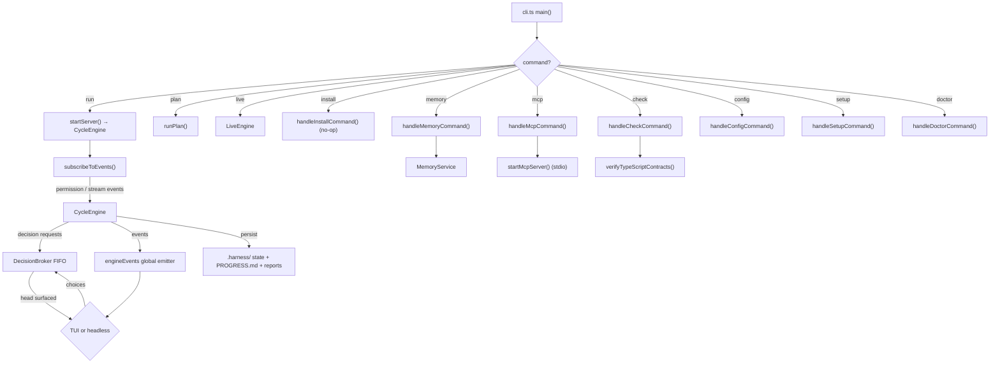

`CycleEngine` is transport-agnostic: it never touches the terminal. Both
frontends (Ink TUI, stdin headless) are thin adapters over the global `events`
emitter plus `engine.resolveDecision()`. Memory persistence, AST indexing,
contract verification, and MCP operations route cleanly through
`handleMemoryCommand`, `handleCheckCommand`, and `handleMcpCommand` without
spawning harness server instances. The same is true of the Phase 3 `setup`,
`doctor` and `config` handlers, which resolve from `src/agents/integrator.ts`,
`src/commands/setup.ts`, `src/commands/doctor.ts` and `src/commands/config.ts`
without an engine.

## 3. The cycle: pipeline-as-data

The core structure is a **data table** instead of hardcoded phase code
(`src/engine/cycle.ts`):

```ts
interface PipelineStep {
  phase: PhaseName;          // SPEC_AUDIT | EXECUTE | ... | COMMIT_ALL
  fn: PhaseFn;               // the phase function from phases.ts
  gate: "spec-audit" | "validate-step" | "judge" | "none";
  fixPhase: PhaseName | null; // FIX_* phase to run when blocked
  fixLabel: string;
  blocking: boolean;
  readOnly?: boolean;        // auditor phases: a tree-hash guard must prove they did not write
}
```

| phase | fn | gate | fixPhase | blocking | readOnly |
|---|---|---|---|---|---|
| SPEC_AUDIT | `specAudit` | spec-audit | FIX_SPEC | ✅ | ✅ |
| EXECUTE | `execute` | none | — | — | — |
| VALIDATE_STEP | `validateStep` | validate-step | FIX_VALIDATE | ✅ | ✅ |
| TEST_MODULE | `testModule` | judge | FIX_TEST | ✅ | — |
| VERIFY | `verifyIteration` | none (structural) | FIX_VERIFY | ✅ | — |
| SECURE_CHECK | `secureCheck` | judge | FIX_SECURITY | ✅ | ✅ |
| REVIEW | `review` | judge | FIX_REVIEW | ✅ | ✅ |
| DOC_SYNC | `docSync` | none | — | — | — |
| COMMIT_ALL | `commitAll` | none | — | — | — |

Every step is a **prompt huginn composes itself** (`src/engine/steps/`), sent through the single
`promptWithContext` seam; no step is an installed slash command, and only `EXECUTE`/the `FIX_*` phases
name opencode's built-in `build` agent (§ 28.2). The `readOnly` flag is enforced at runtime: the
engine hashes the work tree before and after the step (`treeHash`) and forces `blocked` when the
signature is missing or changed (§ 5).

`VERIFY` is the one step that is **not** a prompt: `verifyIteration` (`src/engine/verify.ts`) runs the
plan's `**Verification:**` commands in the iteration sandbox with a per-command deadline and process
group termination, and returns `authoritativeVerdict` from the real exit codes. The plan parser
(`src/plan/parser.ts`) supplies those commands, plus `Goal` and `Acceptance criteria`, to `EXECUTE`,
`TEST_MODULE` and the QA audit. A plan without the sections passes with a note (`--no-verify` skips
the execution entirely).

After the phase loop, `CycleEngine.runIteration` makes the increment atomic: it calls
`WorktreeManager.commitPendingChanges` for anything `COMMIT_ALL` left uncommitted, writes the receipt,
and only then promotes the sandbox. A dirty sandbox with zero commits is a failed promotion that
preserves the worktree; an abort discards the sandbox and leaves the primary tree at the last
promoted increment.

That table is the **Huginn Cycle** — `profile: "huginn"`, the default. Since REQ-36 the pipeline is
selected per run from `PROFILES` (`src/engine/profiles.ts`), a record of named `PhaseName[]`
pipelines; `sdd`/`odd`/`rdd` reorder or subset these same steps (each step keeps its own `gate`/`fix`
column), and `strict-tdd` adds a second `TEST_MODULE` that is *expected to fail* and never blocks
(REQ-36, § 27.4). Every profile runs `VERIFY` before `COMMIT_ALL`, so no methodology can promote an
unverified increment. `--only-phase` validates against the union of every profile's phases.

The retry/fix/escalation loop (`runPhase`) is the same for every step:

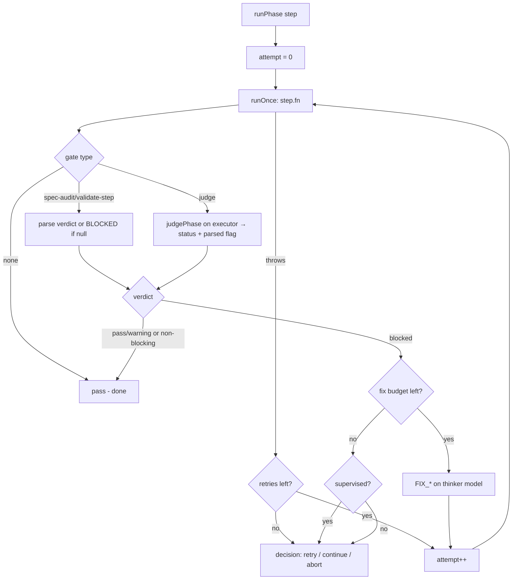

Key behaviors:

- **Greenfield skip**: `SPEC_AUDIT` never runs against a repo with no
  implementation code. `hasImplementationCode` (`src/engine/diff.ts`)
  classifies the repo from `git ls-files --cached --others --exclude-standard`
  — a file counts when it has a source extension from `SOURCE_EXTENSIONS`, is
  not in an ignored dir, and is not a hidden or doc file (config/scaffolding/
  docs don't count). When false, the phase is recorded with verdict `skipped`
  (`recordSkippedSpecAudit`): a history entry and verdict event, but no agent
  call and **no attempt counted** (`phaseAttempts` untouched, so a later real
  audit on resume still starts at attempt 1).
- **Attempt counting** is per `iteration:phase` and persisted in
  `state.phaseAttempts`, so resume continues the numbering (`state.phaseAttempts[key]`).
- **Phase exceptions** (provider stall, timeout, API error) are treated like a
  blocked gate for retry purposes but *never* trigger a thinker fix — they retry
  then escalate (`recordError` writes a `blocked` history entry with a report).
- **Empty `EXECUTE` reports fail closed**: `session.prompt` can resolve on a
  step boundary (e.g. a reasoning-only turn) while the build agent is still
  working, yielding a report with no output. An empty `EXECUTE` result is
  thrown as a phase failure — retried, then escalated — never counted as a pass.
- **Fix phases close their UI row**: `recordFix` emits a `pass` verdict and a
  `phaseEnd` for the `FIX_*` phase (after `runPhase` already emitted its
  `phaseStart`), so the dashboard's fix row terminates with a verdict instead
  of hanging in a spinner state.
- **`retry` from a decision resets the whole budget** (`attemptRun = -1`), so a
  human can keep fixing manually and re-running.
- **`--only-phase`** runs just one step per iteration and leaves state
  resumable: no `finishedAt` is written and `done` is set after the single phase.

## 4. The decision flow (DecisionBroker)

Decisions come from multiple producers:

1. The **engine** — `gate-blocked` escalations, `approve-draft`, `scope-extraction`, and `draft-format` decisions (`requestDecision`).
2. The **event subscription** — `permission` and `question` requests in
   `--permissions ask` mode (`subscribeToEvents` in `src/engine/permissions.ts`).

Both funnel into one FIFO broker (`src/engine/decisionBroker.ts`):

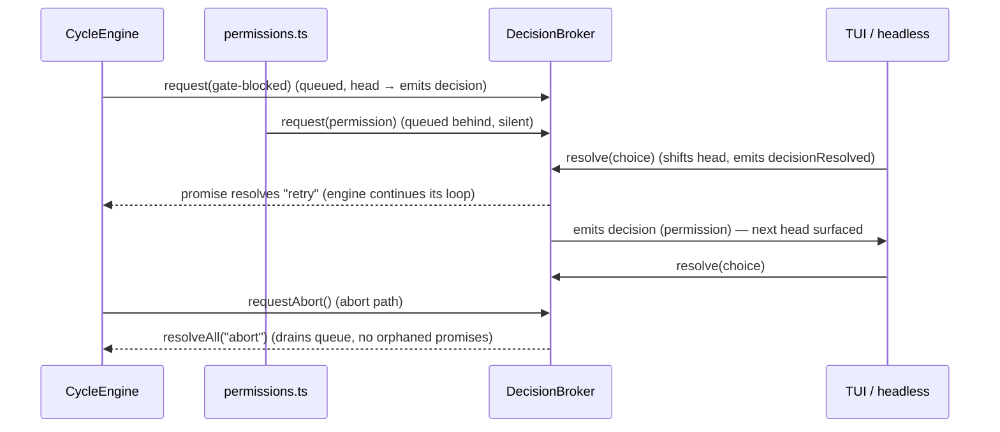

Why FIFO matters: both request kinds can be in flight at once. If the UI
rendered only "the latest" request and resolved that one, the earlier promise
would never settle and the engine's `await` would hang forever. Surfacing only
the head and resolving in arrival order guarantees every request gets exactly
one answer. `resolveAll` on abort/error is the safety net that guarantees no
pending `await` outlives the run.

Frontend mapping of choices:

- Headless TTY: `r`/`c`/`a` (gate), `a`/`o`/`d` (permission).
- Headless non-TTY: permission → `deny`, gate → `abort` (state preserved for resume).
- TUI: same keys; `space`/`p` toggles engine pause (polled every 200 ms), `q`/`Esc` aborts.
- Permission `ask` answers map to opencode responses: `deny`→`reject`,
  `continue`→`always`, `retry`→`once`.

## 5. Gate model

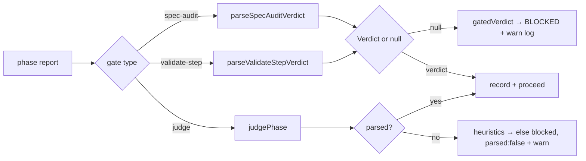

- The two parser functions return `Verdict | null`. `null` means "no parseable
  marker" and the engine's `gatedVerdict()` maps it to `blocked` with a warning
  — **fail closed**.
- **Structural verdicts win**: when a phase computed the verdict itself it travels as
  `authoritativeVerdict` on the phase result (`resolveStructuralVerdict`), and `runPhase` gates on that
  field instead of re-reading the report text — so a report whose prose contradicts its own gate line
  cannot change the outcome. `VALIDATE_STEP` is the case that matters: huginn runs the qa/spec-auditor/
  security sub-prompts itself, computes the verdict from their `### Audit status:` / `### Overall
  fidelity:` lines (`computeValidateVerdict` — empty or marker-less → `blocked`), lets the synthesis
  only *escalate* it, and rewrites the report's gate/handoff lines (`enforceValidateVerdict`) so
  exactly one coherent verdict remains (§ 28.2).
- **Read-only guard**: for the auditor phases the engine hashes the work tree
  (`treeHash`) before and after the step; a missing or changed signature forces `blocked`
  (`readOnlyTreeViolation`) and the phase's own verdict is discarded — an audit that wrote to the
  repository can never pass a gate.
- `validate-step` verdicts still merge every signal by severity (`blocked > warning >
  pass`): the `### Overall gate:` line, the trailing handoff markers the embedded
  validate-step instruction carries, and near-miss prose. Severity merging
  means a contradiction (e.g. a 🟢 overall gate plus a `🛑 BLOCKED` handoff)
  can never downgrade the report; the prose signals are negation-aware so a
  clean report listing what it does NOT contain (`no 🔴`, `not blocked`) is not
  misread.
- `spec-audit` verdicts come from the `Overall fidelity:` line or the bare
  keywords `MAJOR DEVIATION` / `MINOR DRIFT` / `ALIGNED`.
- `judgePhase` asks the **executor** model to classify a report as strict JSON
  (`extractJson` does brace-matching extraction; `normalizeJudgeOutput`
  validates the shape). Reports are truncated to 24 000 chars before judging.
  If the judge's own output can't be parsed, keyword heuristics run, and if
  those also fail the gate fails closed to `blocked` (`parsed: false` is logged
  so unreadable-judge events are distinguishable).
- Non-blocking steps (`EXECUTE`, `DOC_SYNC`, `COMMIT_ALL`) record their verdict
  but never stop the pipeline.
- `skipped` is a fourth `Verdict` value that lives *outside* the gate model: it
  is never returned by the two parsers or the judge — only by the greenfield
  `SPEC_AUDIT` skip — and it neither passes nor blocks the pipeline. The
  progress renderer and both frontends treat it as a pass-equivalent
  (`STATUS_GLYPHS.skipped`, `–`) for display.

## 6. Timeout model

Every model interaction goes through `withTimeout` (`src/server/client.ts`):

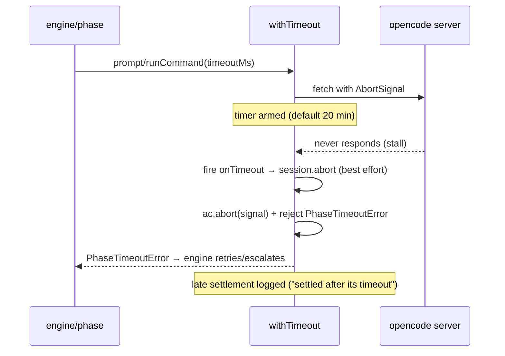

- `timeoutMs <= 0` disables the deadline entirely (no `AbortController`).
- On timeout the **local fetch is aborted** *and* the **server-side agent is
  interrupted** via `client.session.abort` (best effort), so the provider isn't
  left churning.
- Settlements that race the timeout are logged (`request settled after its
  timeout; the provider may still be processing`) instead of corrupting results.
- The same mechanism backs `huginn plan`'s and `huginn live`'s 20-minute
  drafting/chat prompts (`PLAN_PROMPT_TIMEOUT_MS` / `LIVE_PROMPT_TIMEOUT_MS`).

## 7. State machine and resume

State is one zod-validated document, `HarnessState` (`src/state/schema.ts`):

```mermaid
stateDiagram-v2
    [*] --> RUNNING: run() starts
    RUNNING --> RUNNING: per phase → persist()
    RUNNING --> COMPLETED: all iterations done (aborted cleared)
    RUNNING --> FAILED: sandbox promotion failed → persist(promotion=conflict|failed), aborted stays false
    RUNNING --> ABORTED: abort or other error → resolveAll + persist(aborted=true)
    RUNNING --> [*]: SIGINT/SIGTERM → requestAbort (interrupts agent + sets flag)
    COMPLETED --> [*]
    FAILED --> [*]: branch preserved under huginn/… ; recover by hand
    ABORTED --> RUNNING: re-run (auto-resume) or --resume
    ABORTED --> [*]: --force-restart wipes .harness/
```

- **Checkpoints**: `persist()` (write `state.json` atomically via tmp+rename,
  regenerate `PROGRESS.md`, emit `stateUpdated`) runs after every phase, after
  fixes, after session creation, and at iteration boundaries. The engine only
  checks the abort flag between steps, so an abort always lands on a consistent
  checkpoint. Requesting an abort (`requestAbort`) additionally interrupts the
  in-flight agent session (`abortSession`, `src/server/client.ts`) so the loop
  observes the abort immediately instead of waiting out a long phase timeout;
  the run's catch path then reports the outcome as *aborted*, not *error*.
- **Resume hash**: `computePlanHash([plan, spec, adr])` is SHA-256 over
  `basename \0 contents \0` per file. Because it uses basenames, the hash is
  identical after the repo is moved/cloned elsewhere (verified by
  `src/state/store.test.ts`). `run` refuses to resume a run whose documents
  changed, unless `--ignore-plan-changes`; `--force-restart` wipes everything.
- **Resume point**: `currentIteration`/`currentPhase` select the exact step.
  `runIteration` captures the resume phase once, then skips steps until it is
  reached (`pastResume` flag); `phaseAttempts` carries over so attempt numbers
  stay monotonic.
- **Session reuse**: `iterationSessionId` is reused when it still exists on the
  server; otherwise a fresh session `iter N: <title>` is created. `--only-phase`
  keeps state resumable (no `finishedAt` written), matching `PROGRESS.md`'s
  RUNNING status.
- **Models on resume**: the saved models/mode are *replaced* by the current
  flags (`state = { ...existing, models, mode }`), so re-running with different
  models is intentional and allowed.
- **Progress counting**: `renderProgressMarkdown` counts only `MAIN_PHASES`
  entries with `pass`/`warning`/`skipped` — the `done/8` gauge can never
  exceed 8 no matter how many `FIX_*` attempts happened.
- **A promotion failure is not an abort (AC-49.3)**: when an iteration's sandbox could not be
  integrated, `run()` records `state.promotion` and finishes with `outcome.reason = "error"` while
  leaving `aborted` **false**, so `PROGRESS.md` and the TUI report the preserved branch instead of
  `ABORTED` (§ 19.4, § 32.1). A run that completes clears a sticky `aborted` flag left by an earlier
  interrupted run, so a resumed-then-successful run cannot report ABORTED beside a successful exit.

## 8. Live mode

`huginn live` is a second frontend-agnostic engine, `LiveEngine`
(`src/engine/liveMode.ts`), that deliberately reuses the pieces `run` already
has instead of inventing new ones:

- **One opencode session** per live session (`huginn live: <project>`), exactly
  like the cycle's per-iteration session; every model call is `prompt` with the
  **thinker** model and the same 20-minute `withTimeout` budget.
- **The DecisionBroker** (`src/engine/decisionBroker.ts`) answers the three
  live decision kinds (`approve-draft`, `scope-extraction`, `draft-format`).
  After handoff to the cycle, `ask`/`resolveDecision`/`requestAbort` delegate
  to the `CycleEngine` instance, so the FIFO queue is shared, not doubled.
- **The plan-mode prompt builders** (`updateSpecPrompt`, `appendAdrPrompt`,
  `remainingPlanPrompt`, `validateDraftFormat`, `OUTPUT_FORMAT_CONTRACT`,
  `unwrapFences` — all exported from `src/engine/planMode.ts`) do the actual
  drafting; live mode adds the format-contract loop around them (validate →
  retry once with feedback → `draft-format` human decision).
- **git as the review surface**: drafted docs are staged as intent-to-add
  (`git add -N`, `stageDocsForReview`) so `git diff HEAD -- spec.md adr.md
  plan.md` shows the drafts; abort drops the staging (`unstageDocs`); approval
  commits them (`commitDocs`, subject `docs(scope): <first line of scope>`)
  and clears stale `.harness/` state before a fresh `CycleEngine` takes over.
- **Session context that survives** (§ 29): `messages` is mirrored to
  `<project>/.huginn/live/sessions.json`, so the conversation outlives a restart *and* the handoff
  (which clears `.harness/` only); a resumed run reattaches to the stored opencode session when it is
  still alive, and a runtime whose backend keeps no history receives a bounded, nonce-delimited
  transcript of the prior turns on every prompt.

```mermaid
sequenceDiagram
    participant U as User (TUI chat / headless idea)
    participant L as LiveEngine
    participant B as DecisionBroker
    participant P as planMode builders
    participant C as CycleEngine

    U->>L: chat(msg) ×N (refine stage)
    U->>L: /draft
    L->>L: extractScope (SCOPE: block, fail-closed)
    L->>P: updateSpecPrompt / appendAdrPrompt / remainingPlanPrompt
    P-->>L: drafted docs (format-contract validated)
    L->>U: stageDocsForReview → git diff HEAD review
    L->>B: approve-draft decision
    B-->>U: head surfaced; choice → L
    U-->>B: continue
    L->>C: commitDocs + resetHarnessState → new CycleEngine
    C-->>U: full 8-phase cycle (same dashboard/session)
```

Scope extraction is the one genuinely new contract: the thinker must answer
with a `SCOPE:` line + fenced markdown block; a missing/unparseable block is
treated like any other gate — fail closed to a human decision
(`scope-extraction`: retry, or fall back to the user's last message).

- **Interactive TUI & Markdown Rendering** (`src/tui/LiveDashboard.tsx`, `src/tui/markdown.tsx`):
  - Two parallel scrollable cards (`ScrollableChatCard` for human-thinker dialogue, `ScrollableStreamCard` for real-time thinking and reasoning tokens) rendered concurrently.
  - `[Tab]` toggles active card focus with visual border highlighting (`cyanBright` on the active panel) when both cards are mounted; if the agent-output card is collapsed (no stream content), it explains that and points at `PgUp`/`PgDn`, and the footer omits the `[Tab] Focus` hint.
  - `[PageUp]` / `[PageDown]` scrolls the focused card by 4 lines at any time without losing in-flight input; `[↑]` / `[↓]` recall previous composer submissions while the draft is empty, and scroll the focused agent-output card when it is shown and focused.
  - Native terminal Markdown token rendering via `MarkdownLine` formats inline bold, italic, code backticks, headers, bullet points, numbered lists, and code blocks natively in Ink.
  - Post-execution continuous loop: after `cycle.run()` in `live` mode, a `post-cycle-live` decision modal reads the **outcome** — completed, aborted, or error with the preserved branch/backups — and prompts the user to either exit cleanly (`[c]` / `[a]`) or return to the live refinement loop (`[r]`) with state and thinker context preserved. A failed promotion can never render “Cycle completed!”.

## 9. Concurrency and event model

The engine is single-threaded and awaits everything, but three sources of
asynchrony interleave:

1. **The opencode event stream** (`subscribeToEvents`) — a long-lived SSE loop
   that can fire a `permission.updated` request *while* the engine awaits a
   gate decision → this is exactly why the DecisionBroker exists. It also
   forwards agent activity to the frontends: text/reasoning deltas and
   tool-execution status into `phaseStream` (as synthetic marker lines such as
   `⚡ [tool: …] running` / `✓ … completed` / `✗ … error` and `📝 Edited file:
   …`), and file-edit / todo-update events into `log`.
2. **The engine's own retry/escalation loop** — driven by the same await chain.
3. **Frontends** — subscribe to `events` and resolve decisions independently.
   Live mode adds two more subscribers (`LiveDashboard.tsx` in the TUI,
   `runLiveHeadless` in headless) consuming `liveStage`/`liveChat`, which hand
   off to the same run-cycle rendering once the docs are approved.

Communication is via a single **global typed emitter**
(`src/engine/engineEvents.ts`):

| event | payload | consumers |
|---|---|---|
| `iterationStart` | iteration, totalIterations, title, modules | TUI header, headless iteration banner |
| `iterationEnd` | iteration, title | (currently no subscriber — reserved) |
| `phaseStart` | iteration, totalIterations, iterationTitle, phase, attempt, model, startedAt | TUI header, headless |
| `phaseStream` | text/reasoning deltas + tool-execution & file-edit marker lines | live output tail |
| `phaseEnd` | full PhaseResult + durationMs | report bar |
| `decision` / `decisionResolved` | request / id+choice | decision box |
| `verdict` | iteration, phase, verdict, attempt, durationMs | phase checklist |
| `log` | level + message + timestamp | log tail |
| `stateUpdated` | HarnessState | emitted after every `persist()`; currently no subscriber (reserved for future state UI) |
| `liveStage` | stage (`refine`/`draft`/`approve`/`execute`) + optional message | LiveDashboard stage header |
| `liveChat` | role (`user`/`assistant`/`system`) + text | LiveDashboard chat panel, headless live chat lines |
| `done` | reason + optional error | TUI exit, run summary |

Listener exceptions are caught and logged per-listener, so a broken subscriber
can't kill the engine. All frontends subscribe and unsubscribe in `finally`
blocks. The only cross-cutting wiring done outside the engines is
`subscribeToEvents`, which is handed the engine's `ask()` as its decision
callback — one line in `cli.ts` (`(req) => engine.ask(req)` / `(req) => live.ask(req)`).

## 10. Built-in step prompts (the installer is gone)

The cycle no longer delegates to opencode agents or commands that must be copied into a config
directory; huginn composes every step's instruction itself and sends it as a prompt (§ 28.2):

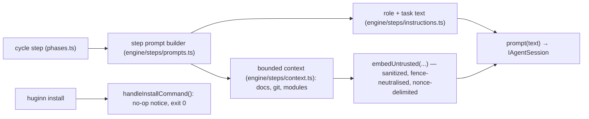

- `src/engine/steps/instructions.ts` inlines the five roles (`spec-auditor`, `qa`, `security`,
  `doc-writer`, `reviewing`) and the task bodies, preserving the exact literals the gates depend on
  (`AUDIT-ONLY MODE`, the `### Overall fidelity:` / `### Overall gate:` markers, the trailing handoff
  lines, the non-interactive/scan guardrails). Nothing is read from disk at runtime, so a bundled bin
  and a source checkout behave identically.
- `src/engine/steps/prompts.ts` composes per-step text; `src/engine/steps/context.ts` provides the
  bounded readers (60 000-character cap, regular-file check) and the git capture (4 s timeout, byte
  ceiling, subcommand allowlist — `diff`, `log`, `status`, `ls-files`, `show` only), the
  `!`git …`` interpolation resolver (with only `head`/`sort` pipes) and the audit/fidelity verdict
  contracts.
- The old `templates/{agents,commands}/` tree, `scripts/postinstall.ts`, `src/setup/install.ts`, the
  `postinstall` script and `HUGINN_TEMPLATES_DIR` are removed. `huginn install` survives as a
  documented no-op (`src/commands/install.ts`) because `install` is still a routed subcommand.
- The two primitives the old installer owned moved rather than vanished: `promptLine`/`promptYesNo`
  (with the `PromptIo` seam) live in `src/util/prompt.ts`, and `getOpencodeConfigDir` in
  `src/setup/opencodeConfig.ts`.

## 11. Key invariants

1. **Fail closed**: no path exists where an unparseable gate report becomes a
   pass. (`gatedVerdict`, judge fallback, both tests.) A huginn-computed verdict is authoritative
   (`authoritativeVerdict`), and a read-only auditor phase whose tree signature is missing or changed
   is forced to `blocked`.
2. **Every decision gets exactly one answer**: FIFO + `resolveAll` on abort.
3. **No state loss**: `state.json` is only ever replaced atomically; the `run`
   cycle never touches plan/spec/adr — the only writers are `plan` mode (at
   creation time) and live mode (human-approved drafts, committed via git).
4. **`.harness/` never participates in the build**: excluded in `.gitignore`
   and filtered out of every git-diff-based helper. Live-session state lives outside it
   (`<project>/.huginn/live/sessions.json`) under a `.huginn/.gitignore` holding `*`.
5. **The pipeline table is the only place phase wiring lives**: adding a phase
   is adding one row (plus its `phases.ts` function and its step prompt).
   The phase-name lists that mirror the pipeline — `MAIN_PHASES`
   (`src/engine/types.ts`), the TUI's `BASE_PHASES` (`src/tui/Dashboard.tsx`)
   and `PHASE_LABEL` (`src/state/store.ts`) — are duplicated by hand and must
   be updated in the same change.
6. **The engine never blocks on a human forever in unattended mode**: non-TTY
   headless aborts gate decisions rather than hanging.
7. **Memory database integrity & privacy**: `muninn.db` runs in WAL mode with foreign keys enabled (`ON DELETE CASCADE`) and `recursive_triggers = ON`; FTS5 indexes are automatically synchronized via database triggers (`obs_ai`, `obs_ad`, `obs_au`); and git remote URLs are sanitized of basic auth credentials before persistence. Non-memory database directories are created with `0o700` (`rwx------`) permissions.
8. **`.huginn/` storage isolation**: Project-local SQLite database files (`muninn.db`, `muninn.db-wal`, `muninn.db-shm`) reside under `<git_root>/.huginn/` and are excluded in `.gitignore`.
9. **FTS5 Query Sanitization**: User-supplied search queries are never passed raw to SQLite FTS5 `MATCH`; `sanitizeFtsQuery` tokenizes input, wraps terms in double quotes, safely handles prefix `*` wildcards, and strips punctuation-only syntax operators to prevent FTS5 syntax errors.
10. **Atomic JSONL Disk Writes with `0o600` Permissions**: `syncToDisk` writes to `.tmp` files with owner-only `0o600` permissions (`rw-------`) before atomic rename, preventing permission leakage and corrupted partial exports.
11. **Chunked In-Memory Join Queries**: Entity hydration queries for observations are capped at 500 parameters per chunk to ensure queries never breach SQLite host parameter boundaries (`SQLITE_LIMIT_VARIABLE_NUMBER`).
12. **MCP Error Isolation**: Tool execution and validation failures caught within `CallToolRequestSchema` return standard `{ isError: true }` responses and never terminate the JSON-RPC stdio transport. Fatal SQLite storage failures (corruption, I/O errors) are logged and rethrown.
13. **Prototype Pollution and Nullish Normalization**: All external MCP arguments pass through `normalizeArgs`, which prunes `__proto__`, `constructor`, and `prototype` keys, strips `null`/`undefined` values, and maps `snake_case` aliases before schema validation.
14. **Bounded MCP Payloads**: Strict Zod length constraints on titles (1,000), content (1,000,000), topic keys (256), symbols (500), queries (2,000), and limits (500) prevent resource exhaustion from model-generated payloads.
15. **Port Decoupling via `IMemoryService`**: The MCP server and its tool handlers depend exclusively on the `IMemoryService` port interface, keeping the transport protocol decoupled from concrete database handles or filesystem implementations.
16. **Stdio Transport Stream Hygiene**: `huginn mcp run` maintains absolute silence on `stdout` (no banners, no startup logging, no ANSI color sequences) to ensure standard JSON-RPC 2.0 frames over stdio are never corrupted.
17. **Disambiguated Keyword Positionals**: The CLI parser separates subcommand names from subsequent positional arguments (`_positionals[0]` vs `_positionals.slice(1)`), preventing argument shadowing when keywords like `"search"` or `"sync"` are searched or referenced.
18. **Boolean Flag Ingestion Safety**: `BOOLEAN_FLAGS` enforcement in `parseArgs` guarantees that standalone flags (e.g. `--import`, `--yes`, `--force`) never consume subsequent positional tokens or flags.
19. **A completed iteration is never stranded or silently discarded**: `promoteSandbox` parks (never overwrites) the local paths an integration would have clobbered — untracked files **and** tracked files with staged/unstaged changes — a failure puts them back (including the index state) and keeps the `huginn/task-iter-<N>` branch, and the run reports a **promotion failure** rather than an abort; the next run renames the branch under `huginn/preserved/` before its sweep, which does not match the reclaim pattern. A `git log` failure is reported as a failure, never as "no commits" (§ 19.4, ADR-48).
20. **One root for Muninn**: the database file and the project row are resolved from the same `--project` root (or the git root of the start directory), and every `.huginn` write — database, JSONL export (both directions), promotion backup — is symlink-screened (§ 13, ADR-49).
21. **A panel never claims output it cannot receive**: `IAgentRuntime.streamsOutput` decides whether an output surface may present itself as live; every other runtime shows the phase report or an idle state (§ 32.2, ADR-50).

## 12. Key tradeoffs (summary; full rationale in ADR.md)

- Pipeline-as-data buys uniform retry/escalation logic at the cost of
  phase-specific control flow living inside the table's `fixPhase`/`fixLabel`
  indirection.
- A single global emitter is simple and decouples the engine from the UI, but
  means any state the dashboard keeps must be re-derived from events (it cannot
  reach into the engine beyond `getState`).
- Bundled step prompts are transparent and versioned with the engine, but they can no longer be
  personalised by the user (the old installer copied them into the opencode config so they could be
  edited) — the parser regexes and the embedded marker lines are the contract, and both now live in
  the same repository, so a change to a marker must update the parser in the same commit.
- All model traffic is synchronous request/response through one opencode
  session per iteration; parallelism (multiple agents at once) is deliberately
  not attempted, which keeps verdict ordering and state trivial.

## 13. Muninn Memory Engine — moved to its own package

The memory engine lives in [dahch/muninn](https://github.com/dahch/muninn) and is consumed as
`@dahch/muninn`. Its design — the SQLite/FTS5 schema, the service core, the MCP server, the CLI, the
contract verifier and the AST indexer — is documented in that repository's `DESIGN.md`, which is where
sections 14–18 of this document moved to (the numbering below is the original, so it skips them).

What stays here: the wrapper surface (`huginn memory`, `huginn check`, `huginn mcp run`), the engine
integration (`src/engine/phases.ts` indexes after `EXECUTE`, `src/engine/liveMode.ts` reads the counts
for the panel) and the data location (`<project>/.huginn/muninn.db`).

## 19. Phase 3 — Live-First Entrypoint, Universal Agent Integrator & Git Worktree Sandboxing

Phase 3 removes three friction points: the CLI required a subcommand plus hand-passed
`--thinker`/`--executor` flags and pre-existing documents; Muninn's MCP server and directives had
to be wired into each agent by hand; and iterations mutated the developer's live working tree
directly. The implementation lives in `src/config.ts`, `src/commands/config.ts`, `src/cli.ts`,
`src/agents/integrator.ts`, `src/commands/setup.ts`, `src/commands/doctor.ts`,
`src/engine/worktree.ts`, and `src/server/client.ts`.

### 19.1 Live-first entrypoint & persistent model configuration

`main()` (`src/cli.ts`) routes on `args._command`. Help is a two-tier hierarchy (Iteration 24,
§ 25.5): `help`/`--help`/`-h` print the banner plus the concise `usageCore()`, `--help --all`
(or `help --all`) print the full `usage()` reference instead, and `huginn init --help` prints the
wizard's own `printInitUsage()`. The subcommands in `KNOWN_COMMANDS` (`run`, `plan`, `live`, `init`,
`install`, `memory`, `mcp`, `check`, `setup`, `doctor`, `config`) route to their handlers.
**Anything else — no command at all, or a bare free-text token such as `huginn "crear módulo de
pagos"` — enters `runLive(args, command)`, and the stray token is passed through as the initial idea
(REQ-14.4)** — with one exception: a *bare* invocation in a repository that has never run huginn
(no `.huginn/`) is onboarded through `handleGreenfieldLaunch` instead (§ 25.4). `run` and `plan`
remain explicit subcommands for batch/CI use.

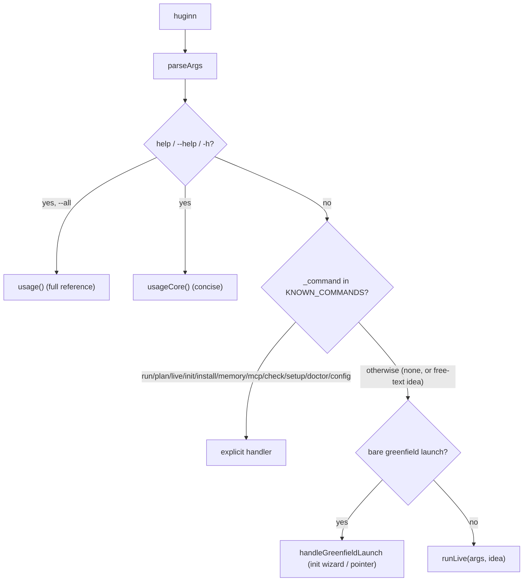

Both `run` and `live` default `--project` to `canonicalize(process.cwd())` (realpath, so embedded
paths match what the opencode server resolves) and resolve models from configuration instead of
erroring on missing flags. A project that is inside **no** work tree is no longer fatal: the command
bootstraps one (`ensureGitRepositoryOrExit` → `git init -b main` + `.gitignore` + bootstrap commit,
§ 28.1) unless `--no-git-init` asks for the fail-closed behavior. `--sandbox` / `--no-sandbox`
are boolean flags (`BOOLEAN_FLAGS`) stored in `RunConfig.sandbox` (default `true`); the live-session
flags (`--continue`/`-c`, `--session <id>`, `--list-sessions`/`-sl`) are boolean/valued flags declared
there too, so a bare `-c` can never swallow the following idea.

#### Model resolution precedence

`resolveModelsFromConfig(sources)` is a pure, injectable function (`sources.env` defaults to
`process.env` only when omitted). First non-empty value wins, independently per role:

| Order | Source | Thinker key | Executor key |
|---|---|---|---|
| 1 | CLI flag | `--thinker <m>` | `--executor <m>` |
| 2 | project config | `<project>/.huginn/config.json` → `thinker` | `executor` |
| 3 | user config | `~/.huginn/config.json` → `thinker` | `executor` |
| 4 | environment | `HUGINN_THINKER_MODEL` | `HUGINN_EXECUTOR_MODEL` |
| 5 | documented default | `anthropic/claude-opus-4-5` | `opencode/gpt-5.1-codex` |

#### Config persistence (`src/config.ts`)

The config schema is `UserConfig = { thinker?: string; executor?: string; mode?: "auto" |
"supervised"; [key: string]: unknown }` — the three documented keys are typed, and every unknown
key is preserved verbatim so third-party configs survive a round-trip.

- **`loadUserConfig(projectPath, homeDir?)`**: reads the user file, then the project file
  overriding it key-by-key. A missing file yields `{}`; malformed JSON or a non-object warns and is
  ignored — **fail-open on reads, never throws**. `sanitizeConfig` builds the result on a
  null-prototype object and refuses the dangerous keys `__proto__`, `constructor`, and `prototype`
  (prototype-pollution defense).
- **`loadConfigLayers(projectPath, homeDir?)`**: reads the user and project files *separately* (no
  merging) so source attribution is exact; `loadUserConfig` merges them key-by-key.
- **`describeModelSources(sources)`**: runs the precedence table above and reports which layer
  supplied each role (`flag` / `project` / `user` / `env` / `default`). `resolveModelsFromConfig`
  is the value-only view of the same single precedence implementation, so the two can never drift.
- **`saveUserConfig(projectPath, config)`** / **`saveGlobalUserConfig(homeDir, config)`**: merge
  with the existing file (unknown keys preserved) and write atomically, hardened against symlink
  swaps: `mkdirSync(.huginn, { mode: 0o700 })`, `lstatSync` refuses a symlinked `.huginn` dir, then
  a temp file created with the exclusive `wx` flag, a random suffix and mode `0o600`, followed by
  `renameSync` into place. A pre-existing symlink at the temp name is never followed (`EEXIST`
  retries once with a new suffix).

#### `huginn config` (`show` / `set`)

`handleConfigCommand` (`src/commands/config.ts`) is the runtime write path for the previously
unreachable config layer:

- **`huginn config show [--project <path>] [--home <path>]`** — prints the effective `thinker` and
  `executor` with the winning layer for each (`loadConfigLayers` → `describeModelSources`), plus
  the resolved project and user config file paths.
- **`huginn config set [--thinker <m>] [--executor <m>] [--global] [--project <path>] [--home <path>]`**
  — requires at least one of `--thinker`/`--executor` (a blank value exits 1 and prints usage) and
  writes to `<project>/.huginn/config.json` via `saveUserConfig`, or to `<home>/.huginn/config.json`
  via `saveGlobalUserConfig` when `--global` is passed. `--project`/`--home` override the defaults
  (homedir), which is how the tests avoid touching the real user home.

### 19.2 Universal Agent Integrator (`huginn setup`)

`huginn setup [--agent <t1,t2|all>] [--installed] [--status] [--dry-run] [--list] [--force] [--project <path>] [--home <path>]
[--opencode-config-dir <path>]` idempotently registers the `muninn` MCP server (command
`huginn mcp run --project <projectPath>`) and injects a marked rules block into every supported
agent. Everything agent-specific lives in the declarative `AGENT_REGISTRY`
(`src/agents/integrator.ts`), so a new agent is a one-row addition (REQ-15).

#### `AGENT_REGISTRY` (13 targets + `all`)

| id | label | MCP config path(s) | format | rules file |
|---|---|---|---|---|
| `cursor` | Cursor | `<project>/.cursor/mcp.json`, `<home>/.cursor/mcp.json` | `mcpServers` | `.cursorrules` |
| `claude` | Claude Code / Desktop | `<project>/.mcp.json`, `<home>/.claude.json`, `<home>/.claude/claude_desktop_config.json` | `mcpServers` | `CLAUDE.md` |
| `opencode` | OpenCode | `<home>/.config/opencode/opencode.json` (honors `HUGINN_OPENCODE_CONFIG_DIR`) | `opencode` (`mcp` key) | `AGENTS.md` |
| `devin` | Devin | `<project>/.devin/mcp_config.json`, `<home>/.config/devin/mcp_config.json` | `mcpServers` | `.windsurf/rules/muninn.md` |
| `qwen` | Qwen Code | `<home>/.qwen/settings.json` | `mcpServers` | `QWEN.md` |
| `codex` | OpenAI Codex CLI | `<home>/.codex/config.toml` | `toml` (`[mcp_servers.muninn]`) | `AGENTS.md` |
| `agy` | Antigravity CLI (agy) | `<home>/.gemini/config/mcp_config.json`, `<project>/.agents/mcp_config.json` | `mcpServers` | `AGENTS.md` |
| `kimi` | Kimi Code CLI | `<home>/.kimi-code/mcp.json`, `<project>/.kimi/mcp.json` | `mcpServers` | `AGENTS.md` |
| `pi` | Pi coding agent | `<home>/.pi/agent/mcp.json`, `<project>/.pi/mcp.json` | `mcpServers` | `AGENTS.md` |
| `commandcode` | Command Code | `<home>/.commandcode/mcp.json`, `<project>/.commandcode/mcp.json` | `mcpServers` | `AGENTS.md` |
| `omp` | Oh My Pi | `<home>/.omp/mcp.json`, `<project>/.omp/mcp.json` | `mcpServers` | `AGENTS.md` |
| `mcode` | MiniMax Code | `<project>/.mcp.json` | `mcpServers` | `AGENTS.md` |
| `mimo` | MiMo Code | `<home>/.config/mimocode/mimocode.json` | `opencode` (`mcp` key) | `AGENTS.md` |

#### Three registration formats

| format | container | written entry |
|---|---|---|
| `mcpServers` | `mcpServers.muninn` | `{ "command": "huginn", "args": ["mcp","run","--project","<path>"] }` |
| `opencode` | `mcp.muninn` | `{ "type": "local", "command": ["huginn","mcp","run","--project","<path>"], "enabled": true }` |
| `toml` | `[mcp_servers.muninn]` | `command = "huginn"` / `args = ["mcp","run","--project","<path>"]` |

- **Portable fallback (AC-15.3)**: every run also writes a standard `mcpServers` file at
  `<home>/.huginn/mcp.json`, independent of the registry, for tools that consume an ad-hoc
  `--mcp-config-file`.
- **Idempotency & `--force` (AC-15.4)**: registration merges into existing config, preserving all
  unrelated keys and sibling servers. An identical existing `muninn` entry is a no-op; a differing
  one is left untouched and reported as `skipped` unless `--force` overwrites it. TOML is parsed
  structurally (the `[mcp_servers.muninn]` table only), never string-appended.
- **File safety (AC-15.6)**: missing parents are created (`0o700`); malformed existing JSON/TOML
  throws a descriptive per-target error and leaves the file untouched; writes are atomic and
  symlink-hardened (exclusive `wx` temp + random suffix + rename). An **existing** target keeps its
  current permission bits (a config the user hardened to `0o600` is never widened); a new file is
  created with `0o600` for MCP configs and `0o644` for rules files.
- **Rules injection (AC-15.5)**: a block delimited by `<!-- huginn:muninn-rules:start -->` /
  `<!-- huginn:muninn-rules:end -->` is inserted or replaced in the target's rules file, leaving
  surrounding user content intact. The block obligates the LLM to call `muninn_context` and
  `muninn_inspect_symbol` before designing changes and `muninn_verify_contract` before emitting
  final code.
- **Path overrides (AC-15.7)**: `homeDir`/`opencodeConfigDir` are injectable; each target's MCP
  paths are overridable via `HUGINN_AGENT_<ID>_MCP_PATH` (colon-separated list), and its rules
  file via `HUGINN_AGENT_<ID>_RULES_PATH` (falling back to a global `HUGINN_AGENT_RULES_PATH`).
  Tests inject temp dirs and never touch the real home.

`setup()` returns a `SetupReport` (`registrations[]`, `rules[]`, `portable`); `handleSetupCommand`
prints per-target paths with `✔`/`•`/`=` markers plus a summary, and sets `process.exitCode = 1`
for an unknown `--agent`. `--list` prints the registry without writing anything.

### 19.3 `huginn doctor`

`runDoctorChecks(opts)` (`src/commands/doctor.ts`) probes the environment with `spawnSync` (Bun
and Node/vitest identical) and returns a structured `DoctorReport` independent of console output:

```ts
interface DoctorCheck {
  id: string; label: string;
  status: "ok" | "warn" | "fail";
  detail: string; critical: boolean;
}
interface DoctorReport { checks: DoctorCheck[]; ok: boolean; }
```

| check | id | critical | fails as |
|---|---|---|---|
| current dir is a git repository | `git-repo` | ✅ | `fail` → exit 1 |
| a runtime (Bun **or** Node) is on `PATH` | `runtime` | ✅ | `fail` → exit 1 |
| Muninn DB opens and `getStats()` reads | `muninn` | ✅ | `fail` → exit 1 |
| `git` binary on `PATH` | `git-binary` | — | `warn` |
| Node runtime on `PATH` | `node` | — | `warn` |
| `opencode` CLI on `PATH` | `opencode` | — | `warn` |
| registry targets already register `muninn` | `integrations` | — | `warn` |

`ok` is `true` only when every **critical** check passed (`checks.every(c => !c.critical ||
c.status === "ok")`). The integration check iterates `listRegistry()` + `resolveMcpPaths()`
(read-only) and reports `N/total` registered. The Muninn check defaults its DB path to
`<projectPath>/.huginn/muninn.db` (never dependent on the process CWD) and always `close()`s the
service. `handleDoctorCommand` prints one colorized line per check (`✔`/`⚠`/`✖`) and sets
`process.exitCode = report.ok ? 0 : 1`.

### 19.4 Git worktree sandbox lifecycle

Each iteration can run in an isolated git worktree so the developer's editor stays on the primary
branch while the agent works (REQ-17). A `Sandbox` is
`{ iteration, path, branch, projectRoot, baseCommit }`; `sandboxBranch(N)` is `huginn/task-iter-<N>`
and `sandboxPath(root, N)` is `<root>/.huginn/worktrees/task-iter-<N>` (AC-17.1/17.2). A branch a failed
promotion has to preserve is moved out of the reclaim namespace to
`huginn/preserved/task-iter-<N>-<stamp>` (ADR-48).

```mermaid
stateDiagram-v2
    [*] --> Created: createSandbox() git worktree add -b huginn/task-iter-N
    Created --> Running: phases run against sandbox.path
    Running --> Promoted: COMMIT_ALL ok → promoteSandbox()
    Running --> Discarded: abort / phase error → discardSandbox()
    Promoted --> [*]: merge --ff-only | cherry-pick; worktree+branch removed
    Discarded --> [*]: worktree+branch removed; primary tree untouched
    Running --> Parked: local collisions (untracked / tracked-modified) → .huginn/promotion-backup/<stamp>/
    Parked --> Promoted: integration retried (ff, else cherry-pick)
    Parked --> Failed: parking failed → no integration attempt
    Running --> Conflict: integration fails both strategies
    Conflict --> [*]: cherry-pick --abort, parked files restored (index state included), worktree removed, branch KEPT, run fails closed as an error
    Failed --> [*]: worktree removed, branch KEPT, parked files put back, run fails closed as an error
```

#### `WorktreeManager` API (`src/engine/worktree.ts`)

| method | behavior |
|---|---|
| `createSandbox(projectRoot, iteration)` | resolves HEAD, **fails closed** (throws, no mutation) if the repo has no HEAD commit or the branch/path already exists, and screens the target path with `assertDocPath` (a tracked `.huginn` symlink cannot redirect the worktree out of the project, SEC-104); then `git worktree add -b <branch> <path> HEAD` (parent `0o700`); symlinks shared deps |
| `promoteSandbox(sandbox)` | parks local collisions (untracked and tracked-modified), then integrates via `git merge --ff-only <branch>`, else `git cherry-pick <baseCommit>..<branch>`; returns `{ promoted, method: "ff"\|"cherry-pick"\|"none", commits, backups?, detail?, failure? }` |
| `discardSandbox(sandbox)` | removes the worktree (`--force`, tolerant) and deletes the ephemeral branch; idempotent; never touches the primary tree |
| `listSandboxes()` | parses `git worktree list --porcelain`, keeping only entries under `<root>/.huginn/worktrees/` |
| `cleanupAll()` | discards every listed sandbox **and** deletes orphaned `huginn/task-iter-*` branches with no worktree (safety net); returns the reclaimed resource count |
| `preserveOrphanBranch(branch)` | renames a preserved sandbox branch out of the reclaim namespace (`huginn/task-iter-<N>` → `huginn/preserved/task-iter-<N>-<stamp>`); returns the new name, or `null` when the name is not a sandbox branch or it does not exist |

- **Dependency symlinks (AC-17.3)**: if `node_modules`, `.env`, `.pi` and/or `.agents` exist at the
  project root and not already in the sandbox, a symlink is created pointing at the root copy (never
  overwriting a real file/dir). This keeps the iteration runnable and keeps the agent's own
  project-scoped MCP config/skills available even when they are untracked. Symlink failures are
  non-fatal warnings.
- **Collision parking (AC-49.1)**: `parkCollisions` handles both classes of paths `git merge` refuses
  to overwrite:
  - **Untracked**: `git ls-files -z --others --exclude-standard` ∩
    `git diff --name-only -z <baseCommit>..<branch>`.
  - **Tracked-modified**: `git diff --name-only -z` (unstaged) and
    `git diff --cached --name-only -z` (staged) ∩ the branch's paths, restricted to paths present in
    `HEAD`. The user's content is copied (or the deletion recorded), then
    `git restore --source=HEAD --staged --worktree` resets the path so integration can proceed.
  - Paths escaping the project and huginn's own `.huginn/`/`.harness/` artifacts are dropped. Partial
    staging and staged *new* files are refused (`failure: "failed"`) rather than guessed.
  - Each one is parked under `<root>/.huginn/promotion-backup/<stamp>/<relPath>`: a **symlink is
    backed up as a link** (never followed), a regular file with its mode minus setuid/setgid bits, and
    anything else (a directory, a FIFO) is refused because it could not be restored. A
    `manifest.json` records every entry (including a tracked deletion and its staged bit). The
    directory is allocated through `assertDocPath` (`action: "write"`, a unique
    `<stamp>`/`<stamp>-<n>` retry), created `0o700` with a self-ignoring `.gitignore` holding `*`, so
    parked content is never committed even on a project whose `.gitignore` does not list `.huginn/`.
- **Promotion & failure policy (AC-17.4, AC-49.2)**: on success the worktree and branch are removed and
  any backup directory is returned in `backups` so the files are discoverable (and named in the run
  log and live post-cycle prompt). On a **conflict** (both strategies fail) the primary tree is
  restored with `git cherry-pick --abort`, **every parked file is put back** — including a tracked
  file's staged/unstaged state (`git add` / `git rm --cached`) — the worktree is removed, but the
  `huginn/task-iter-<N>` branch is **kept** so the sandbox work stays recoverable by hand; the result
  carries `failure: "conflict"` and a sanitized `detail`. A parking failure never attempts the
  integration at all: the result is `failure: "failed"` with the branch (and any un-restorable backup
  directory) preserved. A `git log` that cannot be read is reported as `failure: "failed"` rather than
  "no commits", so a read error can never delete a branch (REV-005). A zero-commit sandbox stays a
  `method: "none"` no-op that still cleans up; only a directory that still holds content is ever named
  in `backups` (NFR-17).

#### CycleEngine wiring (AC-17.6)

`RunConfig.sandbox` (default `true`) gates the behavior; `CycleEngineOptions.worktrees?` allows an
injected manager (tests), otherwise one is created lazily against `cfg.projectPath`.
`sandboxingEnabled()` requires **both** the flag and an existing HEAD commit: a greenfield repo with
no HEAD cannot create a worktree, so the engine warns once and runs that run in place instead of
letting `createSandbox` throw.

- At the start of `run()`, when sandboxing is enabled, a branch a previous **failed** promotion
  preserved (`state.promotion.status` is `conflict` or `failed`) is first renamed by
  `preserveOrphanBranch` — it holds the only copy of that iteration's commits, so it must leave the
  reclaim namespace before the sweep and be logged as such — and then a best-effort `cleanupAll()`
  reclaims the worktrees **and** the orphaned `huginn/task-iter-*` branches (e.g. a branch preserved by
  a conflicted promotion) left behind by a crashed prior run. A `huginn/preserved/*` branch is never
  swept: it does not match the reclaim pattern. Each iteration resets `state.promotion` (and the
  engine's in-memory copy) so one iteration's outcome can never be read as the next one's.
- In `runIteration`, `createSandbox(projectRoot, iteration.index)` is called first (so its path can
  scope the agent session), then `workPath = sandbox?.path ?? projectPath`. `ensureSession` always
  creates a **fresh** `iter N: <title>` session under sandboxing — a persisted
  `iterationSessionId` was bound to a different directory and is never reused.
- **The agent is bound to the sandbox through the opencode SDK `directory` query parameter, not
  just rewritten paths.** `createSession`, `prompt` and `runCommand` in `src/server/client.ts`
  forward a `directory` to the server (the phase pipeline only uses `prompt` — see § 28.2), and
  `PhaseContext.directory` is set to `workPath`; `agentDirectory(ctx)` (`ctx.directory ??
  ctx.projectPath`) is passed to every phase prompt, including the `FIX_*` thinker prompts. The
  `PhaseContext` also carries
  `projectPath = workPath`, `baseCommit = headCommit(workPath)`, and the `spec/adr/plan` doc paths
  mapped into the sandbox (`sandboxDocPath`), so harness-side module inference (`inferModules`) and
  the compiler paths use `workPath` too. **Muninn is the deliberate exception**: the `PhaseContext`
  also carries `dbPath` (resolved from the primary `RunConfig.projectPath` via
  `resolveDatabasePath`) and `primaryProjectRoot` (= `cfg.projectPath`), so `commitAll` **scans**
  modified files from `workPath` but **persists** the symbol graph to the primary project's
  `.huginn/muninn.db` and attributes entities to the primary project record — durable memory must
  outlive the ephemeral sandbox (SPEC AC-17.6, ADR-20). Indexing still runs during `COMMIT_ALL`
  (before promotion), so a failed/aborted promotion can leave phantom entities for code that never
  landed; this is an accepted trade-off documented in ADR-20.
- On iteration success (no abort, not `--only-phase`), `promoteSandbox` integrates the commit into
  the primary branch, logs the method/commit count and the backup directory when files were parked,
  and records `state.promotion = { status: "promoted" | "none", branch, backups? }`. On abort or a
  thrown phase error a `finally` block `discardSandbox`s, exactly once (`settled` flag), never touching
  the primary tree.
- **A promotion failure fails the run closed and is not an abort (AC-17.4 / AC-49.3)**:
  `promoteSandbox` has already restored the primary tree and preserved the branch, so `runIteration`
  throws — the message names the branch and the recovery command, and states that a re-run renames it
  under `huginn/preserved/` rather than deleting it. `run()` records the structured promotion record
  (`status: "conflict" | "failed"`, `branch`, `backups?`, `detail?`), sets `outcome.reason = "error"`
  and finishes as an **error**; `state.aborted` is deliberately *not* set, so `PROGRESS.md` renders the
  promotion failure distinctly instead of `✕ ABORTED`. A run that completes clears the sticky
  `aborted` flag (`state.aborted = false`), so a resumed-then-successful run cannot report ABORTED
  beside a successful exit.
- **An interrupted iteration is parked, not discarded (ADR-56)**: on abort (and on `SIGINT`/`SIGTERM`
  through `parkForResume()`) every live sandbox is committed (`chore(iter-N): interrupted checkpoint`)
  and left on disk. `state.resume` names the step that was **in flight** (written *before* the step
  runs, so a `SIGKILL` still records it) and the pre-run sweep only keeps that one sandbox
  (`cleanupAll(keepIteration)`). The next run reattaches it (`attachSandbox`) and restarts exactly that
  step: earlier steps keep their work, and a step that was interrupted is re-run rather than skipped.
  A cursor naming a different iteration is stale and dropped; a missing worktree falls back to a fresh
  sandbox and a full replay.
- **The live hand-off only resets `.harness` when the plan changed**: `execute()` compares
  `state.planHash` with the documents it just committed, keeps the state (and the cursor) when they
  match, and passes it to the `CycleEngine`. A corrupt state file is treated as "not resumable", never
  as a crash.
- `--no-sandbox` preserves the previous in-place behavior exactly. `cleanupSandboxes()` delegates to
  `cleanupAll()` for an explicit reclamation; `parkForResume()` — not a cleanup — is what
  `SIGINT`/`SIGTERM` register in `cli.ts` for both `run` and the live handoff path.

---

## 20. Phase 5 — Fullscreen Terminal UI & Viewport Engine

Iteration 19 transforms Huginn's Ink-based terminal user interface from an inline stdout-streamed view into a fullscreen application running in the terminal's Alternate Screen Buffer, with responsive viewport scaling, hot console log interception, and stream batching.

### 20.1 Alternate Screen Buffer & Lifecycle Guarantees (`src/tui/render.tsx`)

Previously, Ink rendered directly to standard stdout inline with prior shell history. Startup banners and server logs polluted the scrollback buffer, and scrolling spilled into the host terminal emulator.

`setupTuiEnvironment()` in `src/tui/render.tsx` establishes strict fullscreen containment:
1. **Entering Alternate Buffer**: Writes `ENTER_ALT_SCREEN = "\x1b[?1049h\x1b[H"` to `process.stdout`, immediately switching the terminal emulator to a clean alternate screen buffer and homing the cursor.
2. **Terminal Restoration (`EXIT_ALT_SCREEN`)**: Restores the primary screen buffer and cursor visibility via `EXIT_ALT_SCREEN = "\x1b[?1049l\x1b[?25h"`.
3. **Multi-Tier Cleanup Safety**:
   - `try...finally` in `renderTui` and `renderLiveTui`.
   - Process signal handlers for `SIGINT` and `SIGTERM`.
   - `uncaughtException` trap.
   - Synchronous `process.on("exit")` listener so cursor visibility and primary screen are guaranteed to be restored even during unexpected or abrupt process termination.

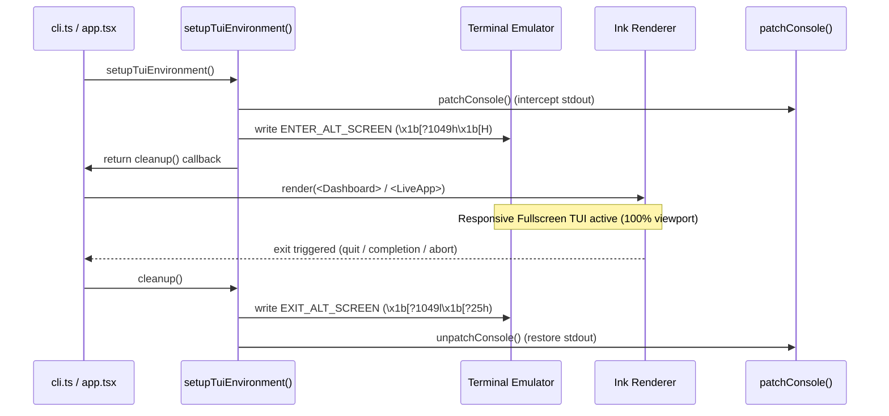

### 20.2 Responsive Viewport Engine (`src/tui/useTerminalSize.ts`)

Card heights were previously fixed (`VISIBLE_CHAT_LINES = 12`, `VISIBLE_STREAM_LINES = 8`), leading to visual clipping on smaller screens and wasted space on larger displays.

The `useTerminalSize()` hook dynamically measures and adapts to terminal dimensions:
- Reads `process.stdout.rows` and `process.stdout.columns` with safe fallbacks (`DEFAULT_ROWS = 24`, `DEFAULT_COLUMNS = 80`) when non-TTY or dimensions are undefined.
- Listens to `process.stdout.on("resize")` and triggers React state updates on dimension changes.
- Layout cards (`ScrollableChatCard`, `ScrollableStreamCard`, `PipelineCard`, `LogsCard`) dynamically calculate their height from available viewport `rows`:
  - `HeaderCard` (the raven header) and `InputBar` / `FooterBar` occupy fixed overhead. The header's row cost is no longer a constant: `useRavenHeaderPlan` / `ravenHeaderPlan` (`src/tui/RavenHeader.tsx`) derives it from the measured columns/rows, the viewport floor and the caller's context rows, resolving mark + wordmark → wordmark-only → plain text, so the header never spends rows the budget did not reserve (REQ-29 / AC-29.3).
  - Middle cards scale to occupy 100% of remaining vertical height without vertical overflow.

### 20.3 Zero Stdout Pollution & Hot Console Interception (`patchConsole`)

To prevent visual tearing and corrupted frames in the alternate screen buffer, stdout emissions are completely eliminated during TUI operation:
- **`patchConsole()` / `unpatchConsole()`**: Intercepts `console.log`, `console.warn`, and `console.error` methods.
- Intercepted messages are formatted using `node:util.format` and dispatched to `events.emit("log", { level, message, timestamp })`.
- **Pre-Mount Log Buffering (`Emitter.logBuffer`)**: `Emitter` maintains a ring buffer of the last 50 log events (`MAX_LOG_BUFFER = 50`) accessible via `events.getRecentLogs()`. Early initialization logs (server startup, provider checks, template warnings) are preserved and displayed in `LogsCard` without leaking raw text to stdout before Ink mounts.
- CLI banner and update checks are conditionally suppressed or routed through `events.emit("log", ...)` when `cfg.tui` is active.

### 20.4 Stream Batching & Scroll Containment

High-frequency token streaming from language models can cause rapid React re-renders, Ink CPU spikes, and terminal flickering:
- **60ms Stream Throttling**: In both `Dashboard.tsx` and `LiveDashboard.tsx`, incoming `phaseStream` event chunks append to an internal ref buffer (`streamBuf.current`) and flush to React state at a throttled interval (minimum 60ms between flushes).
- **1,000-Line Ring Buffer**: Stream lines are clamped to the latest 1,000 lines, preventing unbounded memory growth during long-running builds.
- **Scroll Containment**: Keyboard navigation (`PageUp`/`PageDown` by 4 lines, `↑`/`↓` line-by-line) operates directly on internal state (`streamScroll`, `chatScroll`). Terminal scrollback remains untainted by mouse or touchpad movements.

## 21. Decoupled Multi-Agent Runtime Architecture (`IAgentRuntime`)

To eliminate hard lock-in to OpenCode and enable seamless orchestration across diverse developer tool ecosystems (Claude Code, OpenAI Codex, Oh My Pi, Command Code, Qwen Code, and custom stdio agents), Huginn implements an explicit Hexagonal (Ports & Adapters) runtime boundary under `src/engine/agent/`.

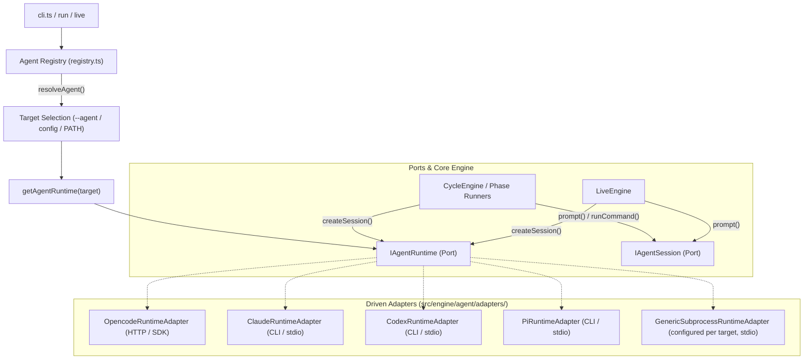

### 21.1 Core Contracts (`src/engine/agent/types.ts`)

The runtime abstraction defines two foundational ports:

1. **`IAgentRuntime`**:
   - `id: AgentTarget` — the provisioning-target id this legacy adapter is shaped for. The port
     layer maps it through `runtimeIdForTarget()` onto a `RuntimeId` (M4b): `pi`, `opencode`,
     `codex`, `claude` or `generic`. `RuntimePort.id` is therefore one of those five.
   - `name: string` — human-readable agent name.
   - `readonly sessionHistory?: boolean` — `true` when the backend keeps the conversation server-side (only `opencode`); every subprocess adapter declares `false` and `undefined` is read as "does not keep history" (§ 29.1).
   - `readonly streamsOutput?: boolean` — whether the runtime can push **incremental** output while a prompt runs: `true` for `opencode` (its server's SSE event stream), `false` on `GenericSubprocessRuntimeAdapter` (and every adapter that inherits it), because a subprocess buffers stdout and resolves once. `undefined` is read as `false`. A surface uses it to decide what the output panel may claim rather than testing a hardcoded id list (§ 32.2).
   - `isAvailable(): Promise<boolean>` — non-blocking probe verifying if the agent's executable binary exists on `PATH` or daemon is reachable.
   - `getAvailableModels(): Promise<ModelInfo[]>` — queries the models the runtime can actually use (never a fabricated catalog); returns `[]` when the runtime exposes no listing mechanism.
   - `getModelCatalog?(): Promise<ModelCatalog>` — richer discovery carrying a `reason` when the catalog is empty, so an empty result is never indistinguishable from a failure (REQ-27/AC-27.4).
   - `getMcpStatus(): Promise<McpStatusReport>` — inspects configured Model Context Protocol servers, transport types, and tool counts.
   - `listMcpServers?(): Promise<McpServerListing[]>` — the agent's own enumeration where its CLI can list servers (REQ-32).
   - `createSession(options: SessionOptions): Promise<IAgentSession>` — creates an execution session bounded to the target directory.
   - `startDaemon?(): Promise<void>` / `stopDaemon?(): Promise<void>` — lifecycle hooks for runtimes requiring background daemons (e.g. OpenCode server).

2. **`IAgentSession`**:
   - `id: string` — unique session identifier.
   - `prompt(text: string, options?: PromptOptions): Promise<PromptResult>` — sends prompts, streaming through stdin where applicable.
   - `runCommand?(command: string, args: string, options?: CommandOptions): Promise<PromptResult>` — translates slash commands or execution directives.
   - `abort(): Promise<void>` — aborts active executions and terminates child process groups.

### 21.2 Concrete Adapters (`src/engine/agent/adapters/`)

- **`OpencodeRuntimeAdapter`**: Wraps `opencode serve` and `@opencode-ai/sdk`. Manages background server lifecycle (`startDaemon`, `stopDaemon`), translates `client.provider.list()` and `client.mcp.status()`, runs sessions via OpenCode's HTTP SDK, and is the only adapter with `sessionHistory = true`.
- **`ClaudeRuntimeAdapter`**: Connects to the Claude Code CLI (`claude`). Supports interactive prompt streaming with `--print` flags and stdin piping.
- **`CodexRuntimeAdapter`**: Integrates with OpenAI Codex CLI (`codex`); model via `-m`, servers via `codex mcp list --json`, no model listing.
- **`PiRuntimeAdapter`**: `-p` with the prompt on stdin, `--model`, `pi --list-models`, and the *assumed* `--approve` (project-resource trust, announced as such).
- **`GenericSubprocessRuntimeAdapter`**: the single reusable adapter/session implementation for every
  target without a dedicated driver. It manages subprocess stdio, process groups, timeouts, native
  model flags, per-target auto-approval args, prompt-file/prompt-value channels, fallback binary
  names and JSON/TOML MCP status inspection. M4b replaced the eight CLI-only classes
  (`agy`, `commandcode`, `devin`, `kimi`, `mcode`, `mimo`, `omp`, `qwen`) plus `cursor` with
  declarative rows in `src/engine/agent/genericTargets.ts`: binary, base argv, prompt channel,
  model flag and permission switch. Their model/MCP listing commands were removed with the
  classes; discovery returns an explained empty catalog and the MCP panel uses config discovery.

### 21.3 Agent Resolution Precedence

When initializing `CycleEngine` or `LiveEngine`, Huginn resolves the active runtime with strict deterministic precedence via `resolveAgent()`:

1. **CLI Flag**: `--agent <target>`
2. **Project Config**: `<project>/.huginn/config.json` (`agent` key)
3. **User Config**: `~/.huginn/config.json` (`agent` key)
4. **Environment**: `HUGINN_AGENT`
5. **Auto-Detection**: Scans `PATH` using `detectAvailableAgents()` for the first installed binary, in `AGENT_TARGETS` order (`cursor`, `claude`, `opencode`, `devin`, `qwen`, `codex`, `agy`, `kimi`, `pi`, `commandcode`, `omp`, `mcode`, `mimo`).
6. **Fallback**: Default to `opencode`.

The stored/env paths are softened for a target that was **removed** (`REMOVED_AGENT_TARGETS`:
`gemini → agy`, `windsurf → devin`, and the eight M4b-retired runtimes `agy`, `commandcode`,
`devin`, `kimi`, `mcode`, `mimo`, `omp`, `qwen` → the `generic` runtime): it warns and falls
through to detection, while any other unknown value is still rejected (SEC-001). The eight remain in
`AGENT_TARGETS` for provisioning and an explicit `--agent <target>` still resolves; only *stored*
values migrate to auto-detection. This check runs **before** the `AGENT_TARGETS` membership test in
both `sanitizeConfig` and `resolveAgent`, otherwise those eight would be accepted as stored runtime
choices.

### 21.4 Security Hardening & Subprocess Isolation

The runtime subsystem incorporates strict security measures:
- **Allowlist Validation (SEC-001)**: `sanitizeConfig` and `getAgentRuntime` strictly reject any target not registered in `AGENT_TARGETS`, preventing malicious repositories from setting arbitrary command executions via `.huginn/config.json`.
- **Safe Stdin Streaming (SEC-002)**: Prompt text is streamed safely through `child.stdin.write(text); child.stdin.end()` rather than passed as positional arguments in `argv`, preventing `ARG_MAX` overflows, argument injection, and exposure in system process tables (`ps`). Where command line flags are required (`promptViaStdin: false`), arguments are size-capped and guarded with `--` option delimiters.
- **Memory Denial-of-Service Defense (SEC-003)**: Output accumulation from subprocess `stdout` and `stderr` is bounded to 10MB (`MAX_OUTPUT_BYTES = 10 * 1024 * 1024`), discarding excessive data and mitigating memory exhaustion.
- **Subprocess Memory Containment (SEC-005)**: the worktree sandbox isolates *where* an agent writes, not *how much* it allocates, so every agent prompt (`generic.ts`) and every `Verification:` command (`verify.ts`) is launched through `src/engine/sandbox.ts` inside a transient `systemd-run --user --scope` with `MemoryMax` (70 % of RAM clamped to 2–12 GiB; `HUGINN_MEMORY_MAX` overrides, `off` disables), `MemorySwapMax=4G` and `TasksMax=1024`. A runaway build is killed in its own cgroup and the phase sees a crashed command; off Linux, without a user manager, or without `systemd-run`, the helper returns the original command untouched. Payload arguments are escaped by doubling `$`, because systemd expands `$VAR` in `ExecStart` and `$$` is its escape (`kill -SEGV $$` would otherwise reach the shell as `kill -SEGV $`).
- **Safe Executable Verification (SEC-004)**: `isExecutableBinary` verifies file existence (`statSync.isFile()`) and execute permissions (`accessSync(..., X_OK)`), ensuring directory matches in `PATH` do not trigger false-positive binary detections.
- **Process Group Termination & Timeout Safety**: Subprocess abortions and timeout expirations send signals to the entire process group (`process.kill(-pid, signal)`) with graceful SIGTERM followed by SIGKILL escalation, preventing orphaned child processes.

## 22. Interactive Model & Provider Selector & Persistence

Iteration 21 introduces interactive model and provider selection, dynamic model discovery across active agent runtimes, in-session switching, and multi-scope atomic persistence.

### 22.1 Motivation & Architectural Objectives

Huginn historically relied on hardcoded defaults (`anthropic/claude-opus-4-5` for thinker and `opencode/gpt-5.1-codex` for executor). If a user launched Huginn with a different agent (such as Claude Code, Codex, or a local provider via Oh My Pi) or lacked API keys for Anthropic or OpenCode, the run would abort with provider errors. Furthermore, users had no mechanism to inspect available models or switch models without stopping their live refinement session.

The model selection architecture achieves four objectives:
1. **Runtime-Driven Model Discovery**: Automatically inspects the models authenticated or supported by the active `IAgentRuntime`.
2. **Interactive 3-Step Selection Modal (`ModelPickerModal`)**: A focused fullscreen TUI modal with live search filtering, provider badges, scroll containment, and format validation.
3. **Multi-Scope Atomic Persistence**: Allows the developer to save chosen models as Project Default (`<project>/.huginn/config.json`), Global Default (`~/.huginn/config.json`), or Session Only.
4. **Frictionless Onboarding**: Auto-detects when default models are absent from the active runtime and automatically guides the developer through model selection on startup.

### 22.2 Selection Workflow & State Machine

`ModelPickerModal` (`src/tui/ModelPickerModal.tsx`) implements a 3-step state machine within the fullscreen TUI:

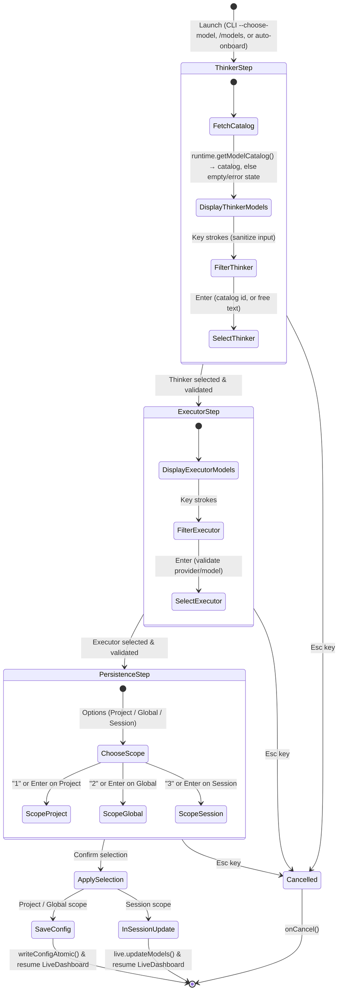

#### Modal Interaction Contract

1. **Step 1: Choose Thinker (`step: "thinker"`)**:
   - Prompts user to select the reasoning, architecture, and gate-fix model.
   - Live query string filters models by `id`, `name`, `provider`, or `description`.
   - Visual provider badges (`[Anthropic]`, `[OpenAI]`, `[Google]`, etc.) visually categorize models.
   - Enter selects the highlighted model (accepted verbatim), or applies the typed custom model string. The `provider/model` requirement is waived for a catalog selection and for runtimes whose own catalog exposes bare ids (`agy`, Command Code): bare text for a fully-qualified runtime is scoped as `${runtime.id}/<text>`, while a runtime that lists bare ids keeps the text verbatim so its CLI can resolve its own short name. With no catalog, no filter and no current value there is nothing to select, and the row reports `No models discovered from <runtime> — type a provider/model id and press Enter`.
   - Validates the canonical `provider/model` syntax (`slashIdx > 0 && slashIdx < modelId.length - 1`) only when the choice is not a catalog/exempt id; invalid formats display an inline error banner (`⚠ Custom models must be in provider/model format`).
2. **Step 2: Choose Executor (`step: "executor"`)**:
   - Prompts user to select the execution model for coding, test execution, gates, and commits.
   - Inherits the catalog and filtering mechanism from Step 1.
3. **Step 3: Save Preferences (`step: "saveScope"`)**:
   - Presents a 3-tier persistence menu:
     - `[1] Project Default`: `.huginn/config.json` (recommended for repo-specific requirements).
     - `[2] Global Default`: `~/.huginn/config.json` (cross-project fallback).
     - `[3] Session Only`: Applies to the current live session without touching the disk.
   - Supports arrow navigation (`↑`/`↓`), vim keys (`k`/`j`), direct numeric selection (`1`, `2`, `3`), and confirmation (`Enter`).

#### React 19 / Ink Reconciler Concurrency Guard

To prevent stale closure bugs under React 19's reconciler with Ink during rapid typing or key navigation, `ModelPickerModal` employs a synchronous ref bridge (`stateRef = useRef(...)`):
```ts
const stateRef = useRef({ ...stateAndProps });
stateRef.current = { ...stateAndProps };

useInput((input, key) => {
  const cur = stateRef.current;
  // all state reads evaluate from cur, guaranteeing fresh references
});
```
Input characters are filtered through `sanitizeKeyInput()` to strip ANSI escape codes and unprintable control characters, preventing terminal sequence corruption.

### 22.3 Provider Catalog Discovery & Fallback Resilience

The modal decouples model enumeration through `runtime.getModelCatalog?()` / `runtime.getAvailableModels()`:
- **Runtime Discovery**: Calls `runtime.getModelCatalog?.()` (falling back to `getAvailableModels()`). When operating with OpenCode, this queries `client.provider.list()` and keeps **only models from providers in the response's `connected` set** (581 on the reference machine, not the 8 195-model catalog), translating them into `ModelInfo` records (`id`, `name`, `provider`, `description`). Runtimes with a listing command use it (after M4b: `opencode` and `pi`); when the SDK/CLI is unreachable it falls back to `opencode models`, and every other runtime returns an explained empty catalog.
- **Honest Empty/Error States (supersedes the old `DEFAULT_FALLBACK_MODELS` fallback)**: an empty or failed discovery shows a distinct empty state ("No models discovered from <runtime> — type a provider/model id and press Enter") plus the sanitized discovery `reason`; a thrown discovery error is surfaced verbatim. No hardcoded catalog is ever substituted.
- **Custom Model Flexibility**: Users are never restricted to pre-discovered models; typing a model id and pressing `Enter` confirms it. The `provider/model` shape is required for free-text ids on fully-qualified runtimes, but a catalog selection — and a bare free-text id on a runtime that exposes bare ids (`agy`, Command Code) — is accepted verbatim.

### 22.4 Slash Commands & In-Session Switching

Live mode provides two complementary slash commands for model management without interrupting the ongoing refinement conversation:

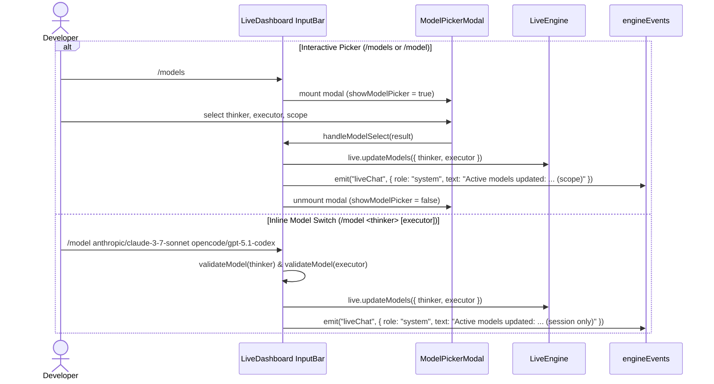

- **/models or /model**: Mounts `ModelPickerModal` over the live dashboard. The chat history and stream state remain in memory; upon completion or cancellation, the dashboard view resumes seamlessly.
- **/model <thinker> [executor]**: Performs an inline, zero-click model switch for the active session. If `executor` is omitted, the current executor is retained. The input string is validated against `provider/model` format, and a system message is emitted to `liveChat` confirming the new models.

### 22.5 Multi-Scope Atomic Persistence Architecture

When the user confirms model selection with `project` or `global` scope, Huginn persists the settings using atomic filesystem operations:

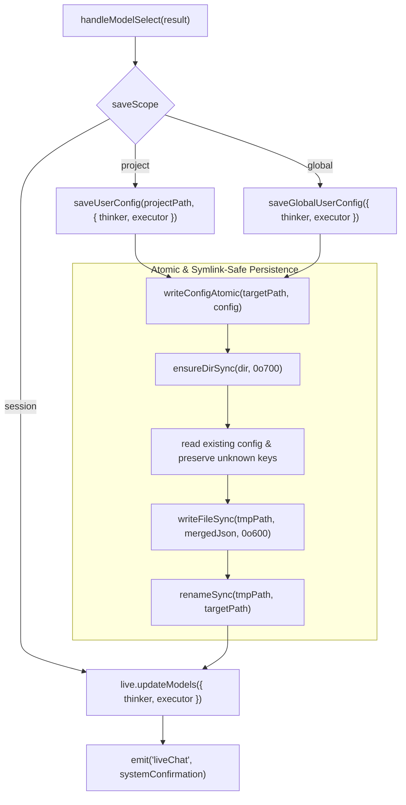

1. **Path Resolution**:
   - Project: `<projectRoot>/.huginn/config.json`.
   - Global: `<home>/.huginn/config.json`, honoring `HUGINN_HOME` environment override or `os.homedir()`.
2. **Atomic Write Guarantee (`writeConfigAtomic`)**:
   - Ensures directory existence with mode `0o700`.
   - Preserves unknown JSON keys already present in the configuration file, allowing third-party tools to store metadata safely.
   - Writes new content to an ephemeral sibling temporary file (`<targetPath>.tmp.<pid>.<random>`) with mode `0o600`.
   - Atomically swaps the temporary file into place via `fs.renameSync()`, preventing partial reads or file corruption on process termination.
3. **Symlink Safety**:
   - Detects symlinks and resolves canonical real paths, preventing symlink traversal attacks outside allowed configuration directories.

### 22.6 Startup Ergonomics & Pre-Flight Auto-Onboarding

Huginn incorporates automated pre-flight checks in `src/cli.ts` (`runLive`):

1. **`--choose-model` CLI Flag**:
   - When passed (e.g. `huginn --choose-model` or `huginn live --choose-model`), Huginn initializes `LiveDashboard` with `showModelPicker = true`, presenting the model picker immediately before any initial prompts or ideas are processed.
2. **Pre-Flight Auto-Onboarding Check (REV-003)**:
   - When Huginn starts, `describeModelSources` inspects where `thinker` and `executor` originated.
   - If either model was assigned from fallback defaults (`source === "default"`), Huginn queries `runtime.getAvailableModels()`.
   - If the active runtime returns an available model catalog and **neither** default model (`anthropic/claude-opus-4-5` or `opencode/gpt-5.1-codex`) is present in the catalog, Huginn automatically enables `cfg.chooseModel = true`.
   - This eliminates confusing runtime failures on fresh installs with non-Anthropic / non-OpenCode runtimes (such as Codex or Claude Code), greeting the developer with an intuitive configuration wizard.

---

## 23. Live MCP Monitor, Inspector & Multi-MCP Configuration

Iteration 22 introduces real-time Model Context Protocol (MCP) health monitoring, an interactive two-pane server and tool inspector modal (`McpInspectorModal`), strict non-blocking timeout protection for the Ink render loop, project-level `.huginn/mcp.json` declaration, and terminal injection defense.

### 23.1 Motivation & Architectural Objectives

Modern AI coding agents rely on tools provided by MCP servers (Muninn memory, filesystem access, git integrations, databases, web search, etc.). In previous iterations:
1. **Zero Runtime Observability**: Developers had no visibility into whether their configured MCP servers were alive, hung, or disconnected during build and refinement sessions.
2. **Render Loop Blocking Hazard**: If an agent runtime attempted to query an unresponsive external MCP server, the synchronous or unconstrained asynchronous call could stall React/Ink rendering, freezing the entire terminal interface.
3. **Lack of Tool Inspection**: Developers had no in-app way to explore available MCP tools, parameters, descriptions, or latency without switching to external terminal windows or configuration files.
4. **Project-Level MCP Disconnect**: Agent-specific MCP paths (e.g. `~/.cursor/mcp.json`, `~/.config/opencode/opencode.json`) were decoupled from repository-specific MCP servers needed for a particular codebase.

The MCP monitoring architecture fulfills four core objectives:
- **Non-blocking Resilient Polling**: Guaranteed deadline enforcement via `Promise.race` ensuring MCP status checks cannot degrade TUI frame rates or block user input.
- **Visual Health Badging**: Dynamic header status reflecting active server counts, tool counts, and degraded/timeout alerts.
- **Interactive Two-Pane Inspector (`/mcp`)**: A keyboard-driven TUI inspector featuring server connectivity details, transport metadata, tool definitions, and paginated windowing.
- **Secure Multi-Source Configuration**: Safe loading of repository-scoped `.huginn/mcp.json` with prototype-pollution prevention, size constraints, and terminal sanitization against ANSI escape injection.

### 23.2 Architecture Overview & Data Flow

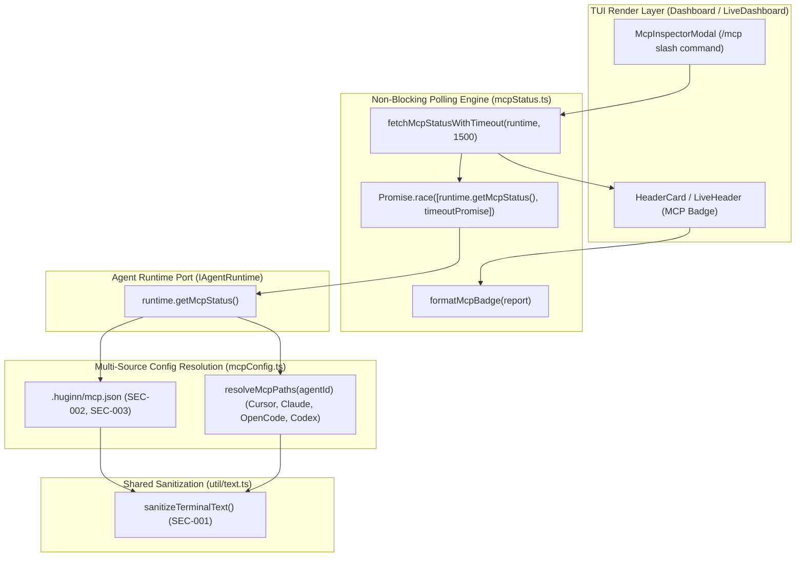

### 23.3 Non-Blocking Polling & Render Protection (`fetchMcpStatusWithTimeout`)

In `src/engine/agent/mcpStatus.ts`, `fetchMcpStatusWithTimeout` provides fail-safe status retrieval:

```ts
export async function fetchMcpStatusWithTimeout(
  runtime: IAgentRuntime,
  timeoutMs = 1500,
): Promise<McpStatusReport>
```

1. **Strict Bounded Race**: Creates an internal timer racing against the runtime's MCP read. The TUI passes a 12 s budget (`MCP_STATUS_POLL_TIMEOUT_MS`, REQ-32) so a slow listing CLI (`opencode mcp list` ≈ 5 s, `commandcode` ≈ 8 s, `claude mcp list` health-checks at ≈ 23 s) is not killed mid-flight; if the budget expires the promise resolves with a degraded status object:
   ```ts
   {
     servers: [],
     totalTools: 0,
     healthy: false,
     degraded: true,
     error: `MCP status timed out after ${timeoutMs}ms`,
   }
   ```
2. **Deterministic Cleanup**: Timer handles are cleared in a mandatory `finally` block to prevent timer leakages across repeated polls, and the deadline timer is `.unref()`'d so a pending probe can never hold the process (or an Ink test runner) open.
3. **Degraded State Normalization**: If any individual server reports `status === "error"` but the overall report does not explicitly flag `degraded`, `fetchMcpStatusWithTimeout` automatically sets `degraded: true`.
4. **Listing-first order + cache (REQ-32)**: when the runtime implements `listMcpServers()`, that enumeration is tried first (it is the only source that can *attribute* servers to the active agent); an empty result falls through to `getMcpStatus()` config discovery, and a listing that outruns the poll still lands in a per-runtime cache (60 s) with a single shared in-flight spawn, so `claude mcp list` is not killed and retried forever.
5. **Periodic Polling Lifecycle**: Both `Dashboard` and `LiveDashboard` poll on mount and every 15 seconds via `setInterval`. Unmount callbacks clear intervals and set `active = false` flags, preventing state updates after component teardown.

#### Status Badge Formatting (`formatMcpBadge`)

`formatMcpBadge(report, agentName)` maps report metrics to concise colored terminal badges. Every badge is **self-describing and attributed** to the active agent (REQ-30 / REQ-32 / AC-32.4; the caller passes `runtime.id`), and every numeric field is nullish-coalesced so `undefined`/`NaN` cannot render (NFR-10):
- **Verified connected (Green)**: `MCP: 🟢 <n> connected (<tools> tools) · <agent>` — only servers a **real probe** reported reachable (e.g. `MCP: 🟢 3 connected · opencode`); the tool count appears only when a probe actually reported it
- **Error (Yellow)**: `MCP: 🟡 error — <sanitized reason> · <agent>` (or `MCP: 🟡 error · <agent>` when no reason is carried) when the report is `degraded`, carries an `error`, or any server reports `status === "error"`
- **Timeout (Yellow)**: `MCP: 🟡 timeout · <agent>` when the failure *is* the deadline (`MCP status timed out after <ms>ms`)
- **Configured / unverified (Gray)**: `MCP: ⚪ <n> configured · <agent>` — servers the agent's own CLI enumerated as configured (`enabled`/`disabled`/`pending`/`unknown`), i.e. known but never probed; only `connected` is ever described as live
- **Empty / Inactive (Gray)**: `MCP: ⚪ none · <agent>` — nothing registered, or nothing reported

### 23.4 Interactive Two-Pane Inspector Modal (`McpInspectorModal.tsx`)

Mounted via the `/mcp` slash command in `LiveDashboard`, `McpInspectorModal` renders a split-pane layout:

```
┌─ 🔌 MCP SERVER INSPECTOR ── 2/2 active ── 12 tools ─────────── Runtime: opencode ─┐
│ ┌─ Servers (2) ──────────────────────────┐ ┌─ Tools for git ───────────────────┐ │
│ │ ▶ git           [connected] [stdio] 5ms│ │   ▲ ... 2 more above              │ │
│ │   memory        [connected] [stdio] 1ms│ │ ▶ git_status                      │ │
│ │                                        │ │     Show current working tree ... │ │
│ │                                        │ │   git_diff                        │ │
│ │                                        │ │     Inspect diff between commits  │ │
│ │                                        │ │   ▼ ... and 3 more                │ │
│ └────────────────────────────────────────┘ └───────────────────────────────────┘ │
│ [↑/↓ or k/j] Navigate · [Tab/Enter] View Tools · [Esc] Close       Focus: servers│
└──────────────────────────────────────────────────────────────────────────────────┘
```

#### Dual-Pane Focus & Keyboard Navigation
- **Left Pane (Servers)**: Displays each server as `name · transport · status · detail` — `[connected]` only for a verified probe, `[unknown]` for a server the agent's CLI reports as merely configured (`enabled`/`disabled`/`pending`), and whatever detail the CLI exposed (command, scope, auth) clamped to one column. Round-trip latency is shown only when a probe actually measured it. The pane header marks unverified servers as `n/total unverified` rather than counting them as active (AC-30.1).
- **Attribution & Muninn (AC-32.3 / AC-38.4)**: a header line names the source runtime (*"Servers come from **&lt;agent&gt;** — add or change them with the agent's own config or CLI; Huginn only observes them"*), and a second line states whether Muninn is registered for that agent (`✓ Muninn (the memory brain) is registered for <agent> … one project-scoped brain, shared by every agent`) or, when absent, the exact fix command `huginn setup --agent <id>`. An unknown server status reads "Status not reported by &lt;agent&gt; — configured, not probed" (AC-32.5).
- **Right Pane (Tools)**: Displays tools exposed by the currently highlighted server, with tool names and descriptions.
- **Focus Toggle**: `[Tab]` or `[Enter]` toggles `focusView` between `"servers"` and `"tools"`.
- **Directional Navigation**: `[↑]`/`[↓]` and `[k]`/`[j]` navigate the active pane. When navigating the server list, the tool list automatically resets selection to the first tool.
- **Dismissal**: `[Esc]` closes the modal, restoring live dashboard chat and input without loss of context.
- **React 19 Ref Bridge (`stateRef`)**: Uses `stateRef` synchronization to prevent stale closures in Ink's `useInput` hook during navigation.

### 23.5 Tool Pagination & Windowing Engine

When servers expose dozens of tools (e.g. AWS or database MCPs), rendering all items would overflow the terminal height. `McpInspectorModal` implements sliding-window pagination:
- **`MAX_VISIBLE_TOOLS = 10`**: Restricts the maximum number of simultaneously rendered tools to 10.
- **Centered Window Calculation**:
  ```ts
  const startIndex = Math.max(
    0,
    Math.min(
      selectedToolIndex - Math.floor(MAX_VISIBLE_TOOLS / 2),
      currentTools.length - MAX_VISIBLE_TOOLS,
    ),
  );
  const endIndex = Math.min(currentTools.length, startIndex + MAX_VISIBLE_TOOLS);
  const visibleTools = currentTools.slice(startIndex, endIndex);
  ```
- **Overflow Indicators**: Displays `▲ ... {moreAbove} more above` and `▼ ... and {moreBelow} more` markers when tools exist outside the current viewport.

### 23.6 Terminal Sanitization & Injection Defense (`sanitizeTerminalText`)

Server names, tool descriptions, and error payloads originate from external processes and untrusted configuration files. Unsanitized strings could emit ANSI escape sequences to hijack terminal cursors, manipulate alternate buffers, or poison logs (`SEC-001`).

`sanitizeTerminalText` lives in the shared module `src/util/text.ts` — relocated out of `src/engine/agent/mcpConfig.ts` so the TUI (`LiveDashboard`, `HelpModal`, `SkillsModal`, `McpInspectorModal`), the agent adapters (`generic.ts`), the MCP monitor (`mcpConfig.ts`), and the skills loader all share one implementation. Every consumer imports it from `src/util/text.js`. It sanitizes all displayed content:
- Strips ANSI escape sequences matching `[\u001b\u009b][[()#;?]*(?:[0-9]{1,4}(?:;[0-9]{0,4})*)?[0-9A-ORZcf-nqry=><]`.
- Strips non-printable ASCII control characters **and the C1 range** `[\x00-\x08\x0B-\x1F\x7F-\x9F]` (the `\x7F–\x9F` addition covers 8-bit CSI/DCS/OSC introducers that the previous pattern left intact).
- Preserves printable whitespace (`\n`, `\t`) and valid Unicode text.

### 23.7 Project-Level MCP Declaration & Configuration Resolution

In addition to target agent configuration files (e.g. `~/.config/opencode/opencode.json`, `~/.claude.json`), `GenericSubprocessRuntimeAdapter` and runtime adapters automatically discover and load project-scoped declarations from `<project>/.huginn/mcp.json`.

1. **Supported Top-Level Keys**:
   - `mcpServers` (standard MCP client format)
   - `mcp` (OpenCode format)
   - `servers` (alternative container)
2. **File Size Defense (`SEC-002`)**:
   - Validates `statSync(configPath).isFile()` and bounds size to `1024 * 1024` (1MB). Files exceeding 1MB or pointing to special device files are rejected with a warning.
3. **Prototype Pollution Guard (`SEC-003`)**:
   - Strips dangerous object properties (`__proto__`, `constructor`, `prototype`) during both JSON parsing reviver and object iteration:
     ```ts
     const parsed = JSON.parse(content, (key, value) => {
       if (isReservedKey(key)) return undefined;
       return value;
     });
     ```
4. **Transport Inference**:
   - If `command` is present, transport defaults to `stdio`.
   - If `url` is present, transport defaults to `sse`.
   - Otherwise honors explicit `transport` string, sanitized against terminal injection.

---

### 23.8 Native driver reporting (`pi`)

The badge originally described the active `IAgentRuntime`. After the native `pi` driver landed, the
engine runtime is a `RuntimePort` wrapped by `toLegacyRuntime`, whose `getMcpStatus()` used to return
an empty, unverified report — so the badge said `none` even when pi had servers. The fix moves the
question into the port:

- `RuntimePort` gains optional `listMcpServers()` and `mcpStatus()`; both bridges forward them, and a
  driver that omits them still yields `unverified: true`, never a healthy report.
- `pi-sdk.ts` implements `listMcpServers()` with `pi mcp list --json` (bounded, `cwd = project`) and
  `mcpStatus()` with `~/.pi/agent/mcp.json` + `<project>/.pi/mcp.json` (`readMcpConfigFile`). The
  listing carries `toolsCount`/`tools`, so `reportFromListings` can total them.
- `fetchMcpStatusWithTimeout` reserves a slice of its budget for the config fallback: a slow listing
  that outruns the poll shows `⚪ n configured` instead of `🟡 timeout`, and the in-flight listing lands
  in the 60 s cache for the next poll.

## 24. Extensible Skills System & Rich Live Slash Commands

Iteration 23 adds a file-based **skills subsystem** (`src/engine/skills/`) and turns the Live console input bar into a first-class command surface (`/help`, `/agent`, `/skills`, `/status`, …) backed by two new modals (`HelpModal`, `SkillsModal`).

### 24.1 Motivation & Architectural Objectives

1. **Project-specific prompting**: teams want reusable, version-controlled prompt fragments (audits, refactors, domain explainers) without editing huginn's source or its embedded step prompts.
2. **Command discoverability**: before this iteration Live mode understood only `/draft`, `/go`, `/quit` and `/abort`; every other `/…` string was silently forwarded to the model as chat text, which produced confusing model replies to typos.
3. **Untrusted input**: skill files and skill directories come from the checked-out repository, so discovery and parsing must be treated as an attack surface (symlink escape, oversized reads, terminal-escape injection, prototype pollution).

### 24.2 Architecture Overview & Data Flow

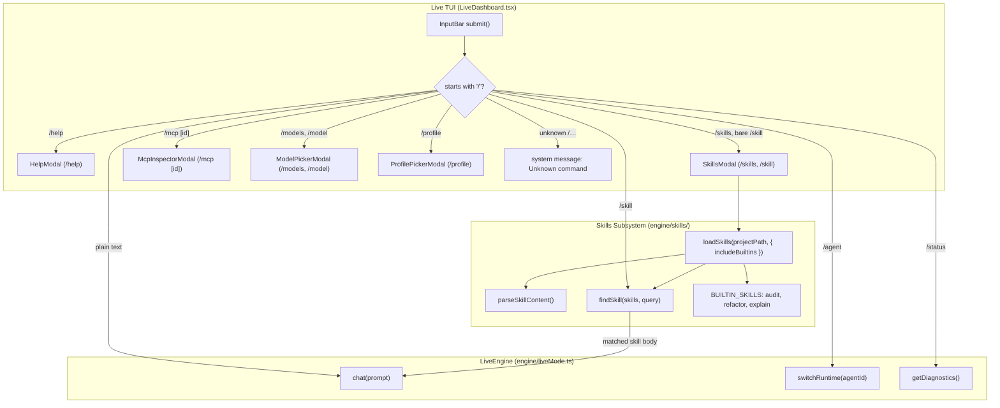

### 24.3 Skill Discovery, Precedence & Built-ins

`loadSkills(projectPath, options?)` (`src/engine/skills/loader.ts`) scans two project-relative directories, in order:

1. `<project>/.huginn/skills/`
2. `<project>/.opencode/skills/`

- **Precedence**: directory order is authoritative — a skill whose lowercased `id` (the `.md` basename) was already seen in `.huginn/skills/` is skipped in `.opencode/skills/`, so `.huginn` wins. Only `*.md` entries are considered; directory listing is sorted for deterministic order.
- **Built-in fallback**: with `includeBuiltins` (default `true`) three shipped skills — `audit`, `refactor`, `explain` (`BUILTIN_SKILLS`) — are appended for any id not shadowed by a project file, so a fresh repo always has usable skills. `includeBuiltins: false` yields project skills only.
- **Lookup**: `findSkill(skills, query)` resolves by exact `id`, then exact `name`, then exact `trigger`, and finally a case-insensitive substring match, so `/skill audit` and `/skill security` both reach the `audit` skill.

### 24.4 Frontmatter Parser & No-Frontmatter Fallback

`parseSkillContent(filename, filePath, rawContent)` implements a deliberately small, flat subset of YAML — not a full YAML parser:

- The `---`-delimited block is matched by `FRONTMATTER_REGEX`; only the flat `key: value` scalars are interpreted:
  - `name` or `title` → `name`
  - `description` or `desc` → `description`
  - `triggers` (or `trigger`) → list, accepting a YAML dash list (`- item`, continuation lines while indented), a bracketed flow list (`[a, b]`), or a bare comma list.
- **Inline `#` comments are stripped** from values, but only when the `#` is preceded by whitespace and outside quotes / brackets; values are then unquoted (`'…'` / `"…"`).
- Block scalars, nested keys, multi-line values and merge keys are **not** parsed and degrade to plain text.
- **No-frontmatter fallback**: `id` is the `.md` basename, `name` defaults to that basename, `description` defaults to the first paragraph (skipping a leading `# Heading`), `triggers` defaults to the lowercased `[basename]`, and `body` is the remaining paragraphs (or empty). A UTF-8 BOM is stripped before parsing.

Every produced field — including `filePath`, `name`, `description`, `triggers` and `body` — is passed through `sanitizeTerminalText` (`src/util/text.ts`), so terminal-escape payloads in a hostile skill file cannot reach the renderer.

### 24.5 Loader Security Hardening

Because skills are read from the repository, the loader treats discovery and reads as untrusted:

- **Scan-root containment**: `resolveContainedSkillDir` `lstat`s the candidate directory (rejecting symlinks and non-directories) and requires `realpathSync(candidate)` to equal `join(realpath(projectRoot), …segments)` **and** to stay under `realRoot + sep`. A hostile repo cannot point `.opencode/skills` at an arbitrary directory outside the project.
- **`O_NOFOLLOW` fd read with a size cap**: `readSkillFile` opens with `O_RDONLY | O_NOFOLLOW` (no symlink following, no stat/read race), `fstat`s the fd, rejects non-regular files and files larger than `MAX_FILE_SIZE_BYTES` (1 MB), and reads only from that fd.
- **Prototype-pollution key skip**: `__proto__`, `constructor` and `prototype` frontmatter keys are ignored during parsing (defence in depth alongside the same guard in the MCP config reader).
- **Terminal-escape sanitization**: see § 23.6 — the single shared `sanitizeTerminalText` implementation applied to every field.

### 24.6 Live Slash Command Dispatcher

`submit()` in `LiveDashboard.tsx` intercepts any input beginning with `/` before it can reach `LiveEngine.chat()`. Command *identity* and aliasing are resolved through the single command registry (`src/tui/commandRegistry.ts`, ADR-28 / REQ-28): `findCommand()` requires a leading `/`, so plain prose that merely starts with a command word is never dispatched as one, and only the per-command argument parsing stays in the `switch` below. The registry is also what the inline `CommandSuggestions` palette and `HelpModal`'s cheat sheet render from, with a drift-guard test asserting the three can never disagree. An unrecognized `/<...>` command is answered with a system message (`Unknown command "<cmd>" — type /help for the command reference.`) and **never forwarded to the model**; a registry entry that has no handler replies with an explicit warning instead of a silent no-op.

| Command | Behaviour |
|---|---|
| `/help` | Mounts `HelpModal` — command cheat sheet, navigation shortcuts, and the active agent/thinker/executor/project banner. `Esc`, `q` or `Enter` closes. |
| `/agent` | Opens the interactive `AgentPickerModal` (REQ-33): every `AGENT_TARGETS` row with an availability marker (`✔` / `— not installed`), the active one marked, and the highlighted entry's detected path; `↑`/`↓`/`j`/`k` move, `Enter` switches (a failed switch keeps the modal open), `Esc` cancels. |
| `/agent <id>` | Hot-switches the runtime via `LiveEngine.switchRuntime(id)`; an unknown id is rejected with the available-target list. |
| `/models`, `/model` | Mounts the interactive `ModelPickerModal`. |
| `/model <thinker> [executor]` (also `/models …`) | Validates `provider/model` syntax for both values (executor defaults to the current one), rejects extra args or malformed values, then calls `LiveEngine.updateModels(...)` for the session. |
| `/profile` | Mounts the interactive `ProfilePickerModal` (REQ-54): every `PROFILES` row with its display name, one-line description and active marker; `↑`/`↓`/`j`/`k` move, `Enter` = session, `p` = project, `g` = global, `Esc` cancels (`§ 32.5`). |
| `/profile <id>` | Validates against `PROFILE_NAMES` and calls `LiveEngine.updateProfile(id, "session")`; an unknown id fails closed with the valid list and the console states that the change applies to the **next** cycle. |
| `/mcp`, `/mcp <id>` | Mounts `McpInspectorModal`, optionally pre-selecting a server by id (`text.slice(4).trim()`). |
| `/skills`, bare `/skill` | Refreshes via `loadSkills(cfg.projectPath)` and mounts `SkillsModal`; `Enter` on a skill executes it (`live.chat(skill.body)`). |
| `/skill <name>` | Resolves `findSkill(...)`; a match runs its `body` immediately, otherwise the browser hint message is shown. |
| `/status` | Calls `LiveEngine.getDiagnostics()` and renders a bordered box (branch, clean/dirty, worktree sandbox, runtime, thinker/executor, resume point, Muninn entity/observation counts). |
| `/clear` | Clears chat messages, stream buffer and both scroll offsets. |
| `/draft` (alias `/go`) | Runs `live.draft()` and, on approval, `onApprove()`. |
| `/resume` | Continues a saved run without re-planning: `getResumePoint()` (which validates `planHash`) then `onApprove()`; with no valid point it answers with a warning pointing at `/draft`. |
| `/quit` (alias `/abort`) | **Two-step confirmation**: the first invocation only asks to confirm; a second within the same session aborts. Any other command resets the pending confirmation. |

Each branch above answers with a sanitized acknowledgement from `feedback.ts` (`✓` result, `⚠` problem naming the next step with the raw cause on a `cause:` line, `…` while running), so no dispatched input is a silent no-op (REQ-31). While a bare `/…` draft has matches, the palette takes `↑`/`↓` (and `j`/`k`) / `Tab` / `Enter` / `Esc` *before* the dashboard's focus-toggle (`Tab`) and scroll-trap (`↑`/`↓`) handlers, and a draft with no matches does not count as open (REQ-28 / AC-28.3).

`SkillsModal` and `HelpModal` follow the same TUI conventions as the other modals: a `stateRef` bridge for fresh `useInput` callbacks under React 19, centered list windowing (`VISIBLE_LIST_ITEMS = 8`, `VISIBLE_BODY_LINES = 8`), `Tab` pane focus, and `Esc`/`q` dismissal. `HelpModal` sanitizes and clamps every external prop at the component boundary, and its `SLASH_COMMANDS` array is now *derived* from the command registry instead of hand-maintained. `ProfilePickerModal` follows the same conventions (`stateRef` bridge, `VISIBLE_PROFILE_ROWS` = 6, `Esc` to cancel) and owns the row budget while it is open, exactly like the palette and the runtime picker.

### 24.7 `LiveEngine` Runtime Switching & Diagnostics

Two engine additions back the dispatcher (`src/engine/liveMode.ts`):

- **`switchRuntime(agentId)`**: resolves the target runtime via the injected `runtimeFactory` (a new optional `LiveEngineOptions.runtimeFactory` field used by tests) or `getAgentRuntime(...)`, then **fails closed** — if `isAvailable()` is false it throws and the active runtime is left untouched. On success it aborts the previous `session` (or `sessionId` via `abortSession`), swaps the runtime, clears the session handle, and sets `needsSystemPrompt` so the architect/system prompt is re-seeded on the next `prompt` rather than lost with the disposed session. A `liveChat` system event announces the switch.
- **`getDiagnostics()`**: returns `DiagnosticsInfo` assembled from best-effort git probes (`rev-parse --abbrev-ref HEAD`, `status --porcelain`, `--git-dir` worktree detection), the active `runtime.name`, the formatted thinker/executor models, and Muninn `getStats()` entity/observation counts — each wrapped in `try/catch` so a missing git repo or uninitialized memory DB degrades to defaults instead of throwing.
- `runtime` is now a **private field behind a public getter** (`get runtime()`), mutated only by the constructor and `switchRuntime`.
- **`getProfile()` / `updateProfile(name, scope)`** (Phase 8, REQ-54): the resolved profile and its setter, which validates against `PROFILE_NAMES`, fails closed on an unknown id, and persists through `saveUserConfig`/`saveGlobalUserConfig` for a `project`/`global` scope (§ 32.5).

## 25. Iteration 24 — `huginn init` Onboarding Wizard, Two-Tier Help & Greenfield Launch

Iteration 24 removes the CLI's remaining first-run friction: a developer who cloned a repository and
typed a bare `huginn` got an unconditional live-mode launch — or the terse `"<path>" is not a git
repository.` failure once live mode reached its git check — with no route to the agent/model/MCP
configuration the engine needs, while `huginn --help` dumped one flat ~90-line string in which the
five commands a newcomer actually wants were indistinguishable from installer internals and
model-resolution precedence. Three changes ship together: a guided `huginn init` wizard, a two-tier
`--help` hierarchy, and greenfield-launch onboarding. The implementation lives in
`src/commands/init.ts` (new), `src/cli.ts`, `src/commands/setup.ts`, `src/util/prompt.ts` (the shared
prompt seam, moved here when the template installer was removed) and
`src/engine/agent/registry.ts`.

### 25.1 Motivation & Architectural Objectives

1. **Onboarding with no new primitives**: every step the wizard needs already exists and is already
   hardened — `handleSetupCommand` (Muninn MCP + rules registration), `saveUserConfig` (atomic,
   symlink-safe, unknown-key preserving), `detectAvailableAgents` (PATH scan over `AGENT_TARGETS`)
   and `promptYesNo` (returns its fallback when non-interactive). `huginn init` is therefore a *thin
   orchestrator*: it adds only `existsSync` probes and sectioned output and delegates the rest. It
   owns no I/O, so it cannot drift from `setup`/`config` semantics.
2. **A scannable help surface**: the concise default must fit on one screen without abandoning the
   full reference, which other tools and `test/muninn/commands.test.ts` assert on — hence two
   functions rather than one aliased string.
3. **Greenfield safety on a live-first dispatcher**: because an unknown or absent subcommand is
   *already* meaningful input (a free-text idea, REQ-14.4), onboarding cannot hijack the no-argument
   case wholesale; it must stay out of the way of `huginn "add a checkout flow"`.

### 25.2 Architecture Overview & Data Flow

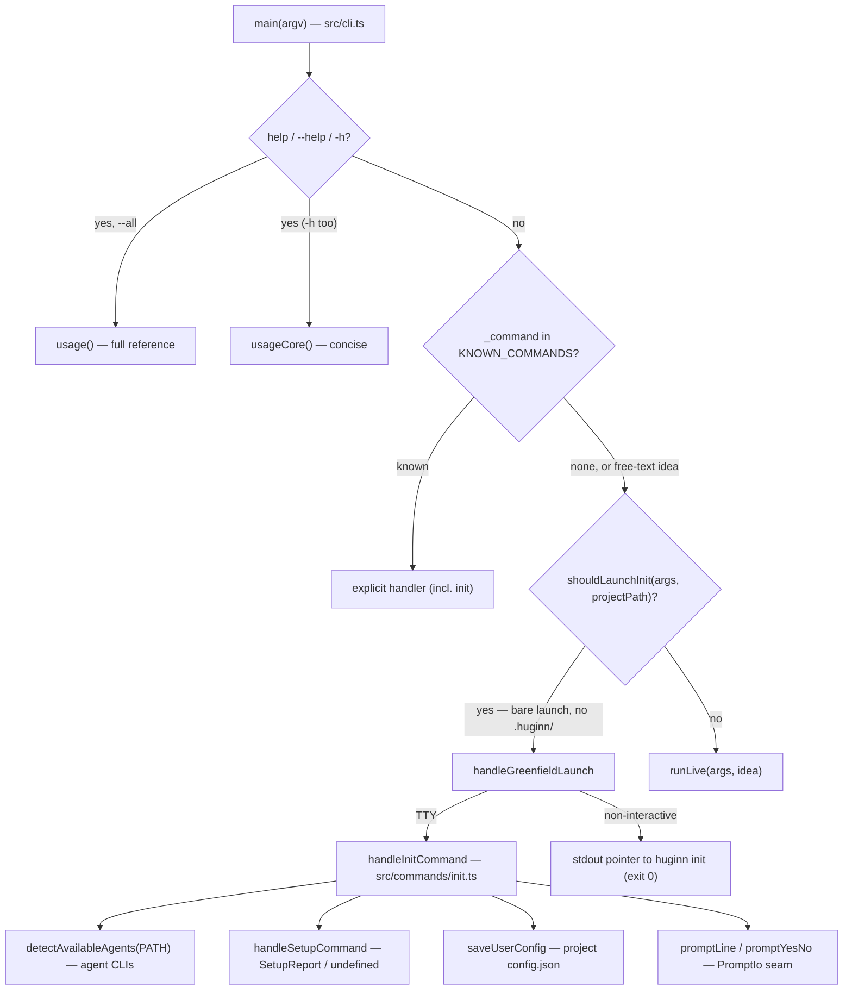

### 25.3 The `huginn init` wizard (`src/commands/init.ts`)

`handleInitCommand(args, deps?)` prints six numbered sections and mirrors each finding into the
returned `InitReport`:

| Step | Detection / action | Source |
|---|---|---|
| 1. Repository | `isGitRepo(project)` (`git rev-parse --is-inside-work-tree` — a subdirectory, a linked worktree or a symlinked checkout counts) — informational only; a missing work tree prints a `git init` tip and never fails | `src/engine/diff.ts` |
| 2. Package manager | `detectPackageManager(projectPath)`: `bun.lock`/`bun.lockb` → `bun`, `pnpm-lock.yaml` → `pnpm`, `yarn.lock` → `yarn`, `package-lock.json` → `npm`, a lone `package.json` → `npm`, nothing → `unknown` (bun wins when lockfiles coexist) | `detectPackageManager` |
| 3. Agent CLIs | `detectAvailableAgents(env.PATH)`, printed primary-first (`PRIMARY_AGENT_CLIS` = `opencode`, `claude`, `codex`, `omp`) then the remaining `AGENT_TARGETS` in registry order; available entries show a green `✔` and their path, unavailable ones are dimmed | `src/engine/agent/registry.ts` |
| 4. Agent & models | TTY-only prompts, else the flags/defaults; the default agent is the first `available: true` entry of the *same* printed list, falling back to `DEFAULT_AGENT` (`opencode`). The models come from a **numbered picker fed by the chosen runtime's catalog** (`discoverModelCatalog` → `getModelCatalog()`), with a plain-text fallback plus the sanitized `reason` when the runtime lists nothing (§ 30) | `promptChoiceDefault` / `promptTextDefault` / `promptModelChoice` |
| 5. Muninn MCP | delegates to `handleSetupCommand({ "--agent", "--project", "--home"[, "--opencode-config-dir", "--force"] })`; `--skip-setup` skips it | `src/commands/setup.ts` |
| 6. Project config | `saveUserConfig(projectPath, { agent, thinker, executor })` → `<project>/.huginn/config.json` (atomic, unknown keys preserved); overwrite prompt on a TTY unless `--force` | `src/config.ts` |

- **Agent precedence inside the wizard**: `--agent` (case-folded, validated by `isAgentTarget`) →
  first detected available of the primary-first list → `DEFAULT_AGENT`. Because the default derives
  from the list the wizard just printed, the pre-selected agent can never contradict the first line
  of section 3 (REV-203). Unlike `resolveAgent`, the wizard reads no config or `HUGINN_AGENT` layer —
  there is nothing configured yet on a greenfield run — and it always writes the *project* config so
  the choices stay repo-local.
- **`InitReport`** is the contract callers consume: `projectPath`, `homeDir`, `configPath`, `agent`,
  `thinker`, `executor`, `setupRan`, `configWritten`. Pure step-mirror state (the git / package
  manager / agent findings) is printed but deliberately not part of it.
- **Non-blocking by construction**: `canPrompt = interactive && !env.CI && !--yes`; otherwise the
  flags and the documented `DEFAULT_THINKER_MODEL` / `DEFAULT_EXECUTOR_MODEL` are used. The only
  interactive question is overwriting an existing config, whose `promptYesNo` fallback is `true`, so
  a non-interactive re-run stays idempotent.
- **Failure semantics**: an unknown `--agent` and a failed config write print an error, set
  `process.exitCode = 1` and return before any write; a failed `huginn setup` delegation warns and
  sets `process.exitCode = 1` but still writes the config so the repository stays usable. The handler
  never throws and never calls `process.exit`.
- **`--help`/`-h`** early-returns `printInitUsage()` and writes nothing: the CLI's
  `huginn init --help` route and a programmatic caller both get the same "print usage, write nothing"
  contract.
- **`InitDeps`** makes every side effect injectable (`projectPath`, `homeDir`, `env`, `isTTY`,
  `stdin`, `stdout`, `detectAgents`, `runSetup`, `promptText`, `promptChoice`, `confirm`, `log`,
  `error`), so `test/commands/init.test.ts` exercises the production readline path against scripted
  TTY streams without touching the real `~`, the real opencode config or the terminal.

### 25.4 Greenfield launch onboarding (`src/cli.ts`)

Three exports add the routing rule without touching the live-first default:

- **`isGreenfieldLaunch(projectPath)`** — `!existsSync(join(projectPath, ".huginn"))`. The `.huginn/`
  directory is created by *every* stateful huginn command (`init`, `config set`, `memory`, live
  state), so its absence is the cheapest reliable "this repository has never run huginn" signal — no
  lock file or version marker needed.
- **`shouldLaunchInit(args, projectPath)`** — true only when there is no `_command`, no `_positional`
  idea, no `--help`/`-h`, no flag outside `BENIGN_BARE_FLAGS` (`--project`, `--home`,
  `--opencode-config-dir`, `--yes`), and the project is greenfield. An explicit idea, a work/mode flag
  such as `--headless`/`--resume`/`--thinker`, or an already-configured project keeps the documented
  live-first behavior, so the caller's explicit intent always wins over first-run guidance.
- **`handleGreenfieldLaunch(args, projectPath, deps?)`** — on an interactive TTY it forwards the
  canonical path as both the `--project` flag (so a raw/relative flag cannot win) and the wizard's
  `projectPath` default, then delegates to `handleInitCommand`; otherwise it prints a four-line
  pointer to `huginn init` / `huginn --help` on **stdout with exit code 0** — an unconfigured
  repository is guidance, not an error. The delegated wizard still reports a failed step (e.g. MCP
  registration) through `process.exitCode` (REV-201).

`main()` applies the predicate only inside the live-first branch (no known subcommand), so
`huginn run --project …` and `huginn "my idea"` are untouched.

### 25.5 Two-tier help hierarchy (`usageCore` / `usage`)

| Surface | Trigger | Content |
|---|---|---|
| `usageCore()` | `huginn --help`, `huginn help`, `huginn -h` | usage line, the five Core commands (`live`, `run`, `init`, `setup`, `doctor`), four copy-pasteable examples, the common flags, and a single "run `huginn --help --all`" pointer |
| `usage()` | `huginn --help --all`, `huginn help --all` | the full reference: every subcommand, every flag and default, and the model-resolution precedence order |
| `printInitUsage()` | `huginn init --help` | the wizard's own flags, steps and non-interactive note |

- `usage()` is kept byte-stable: `test/muninn/commands.test.ts` asserts on it (e.g. the
  `huginn memory init …` line) and it remains the long-form reference; `usageCore()` is a strict
  subset of it. All help surfaces print the banner first (`printBanner({})`) and exit 0.
- `--all` (and the wizard's `--skip-setup`) were added to `BOOLEAN_FLAGS` so `parseArgs` never
  swallows the following argument.
- **Drift guard**: `test/commands/init.test.ts` parses the `Core commands:` block out of
  `usageCore()` and asserts it is exactly `["live", "run", "init", "setup", "doctor"]`, that every
  one of those tokens also appears in `usage()`, and that `usage()` is longer than `usageCore()` — so
  the subset relationship is enforced rather than assumed.

### 25.6 Shared prompt seam & delegated-setup contract

Three small extractions keep the wizard from re-implementing existing behaviour:

- **`promptLine(question, fallback, io)` + `PromptIo { env?, stdin?, stdout? }`**
  (`src/util/prompt.ts`) — one readline implementation whose TTY/CI guard and `node:readline`
  plumbing are shared. `promptYesNo(question, fallback, io)` now delegates to it (asking `[y/N]`
  with the `"yes"`/`"no"` fallback), so the `install` command and the wizard read answers through the
  identical seam; every field defaults to the real `process.*` primitive, so production callers omit
  it, and a blank answer resolves to `fallback`.
- **`handleSetupCommand` returns `Promise<SetupReport | undefined>`** (`src/commands/setup.ts`) —
  `undefined` for `--help`/`--list`, an unknown agent, or a failed `setup()`. Handlers in this CLI
  signal failure through `process.exitCode`, so a merely-resolved `await` is *not* success: the
  wizard sets `setupRan` only when the delegation both returned a report and left
  `process.exitCode !== 1` (REV-201). `src/cli.ts`'s own `setup` route ignores the return value.
- **`isAgentTarget(value): value is AgentTarget`** (`src/engine/agent/registry.ts`) — the single
  `AGENT_TARGETS` allowlist check, now exported and reused by `resolveAgent`, the CLI and the wizard
  (replacing `resolveAgent`'s former private `isTarget` closure), so the membership test exists once.

## 26. Phase 6 — Runtime Fidelity, Discoverability & Live Diagnostics

Phase 6 fixes what a hand-driven session on a real machine proved broken: model discovery that either
returned an unusable catalog or silently substituted a fabricated one, a TUI that never showed what
could be typed, an eagle where the raven belonged, and an MCP badge that claimed liveness Huginn had
never verified. The implementation lives in `src/engine/agent/adapters/` (plus `modelList.ts`),
`src/engine/agent/mcpStatus.ts`, `src/tui/commandRegistry.ts`, `CommandSuggestions.tsx`,
`RavenHeader.tsx` (with `src/brand.ts`), `feedback.ts`, `src/commands/memory.ts` (the
wrapper), the `@dahch/muninn` MCP server, `src/server/lifecycle.ts` and `src/engine/liveMode.ts`. Nothing in the
engine's phase pipeline, the sandboxing model, the Muninn schema or the `provider/model` wire format
changed.

### 26.1 Truthful cross-runtime model discovery & native selection (REQ-27)

`getAvailableModels()` is now a thin projection of the optional richer `getModelCatalog()`
(`{ models, reason? }`), and **no** adapter invents a model any more — the previous
`anthropic/claude-opus-4-5` / `opencode/gpt-5.1-codex` substitution and the generic
`${id}/default` literal are gone. Discovery is per runtime:

| runtime | listing mechanism | verified |
|---|---|---|
| `opencode` | `client.provider.list()` intersected with the response's **`connected`** provider ids; on throw/empty, the `opencode models` CLI | 581 of the 8 195-model catalog |
| `pi` | `pi --list-models` | captured in `test/fixtures/pi-models.txt` |
| `claude`, `codex` | none → `[]` **with a reason** | — |
| `generic` (`cursor`, `agy`, `commandcode`, `devin`, `kimi`, `mcode`, `mimo`, `omp`, `qwen`) | none → `[]` **with a reason** | — |

M4b removed the per-CLI listings that this Phase 6 table originally recorded: `commandcode
--list-models` (82), `omp models` (192), `agy models` (14), `devin models list`, `mimo models` and
`kimi provider list --json`, together with their parsers and fixtures. Those targets are still
provisioned and run through `generic`; their discovery is now honestly empty instead of carrying a
format-specific parser for a runtime that no longer exists.

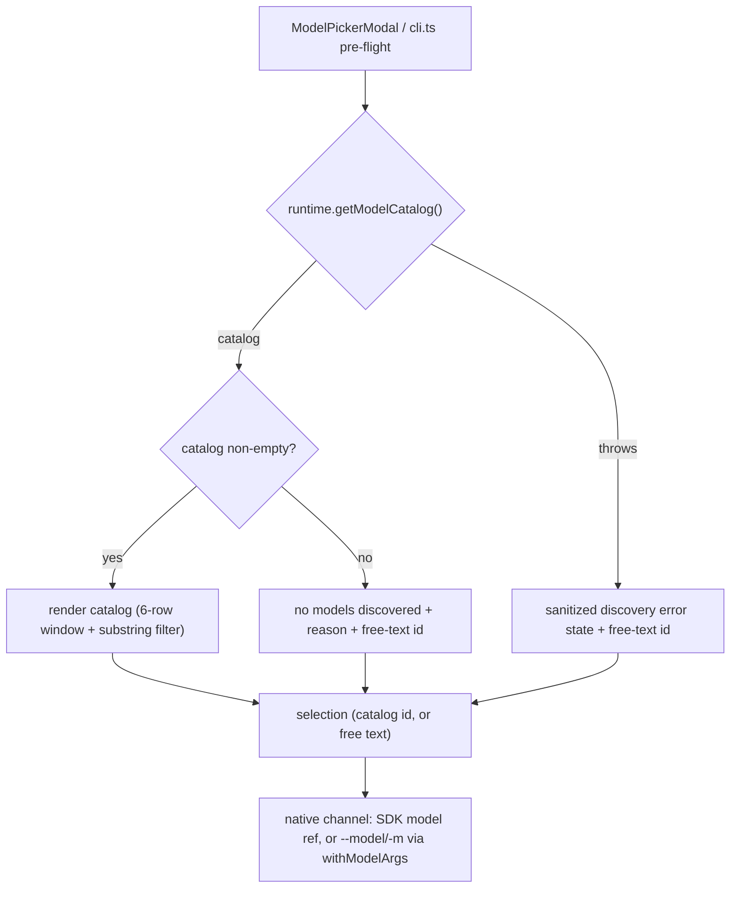

- **Reasons are discriminating.** Every empty result comes from `runModelListCommand`
  (`src/engine/agent/adapters/modelList.ts`), which never throws and never fabricates: a missing
  binary (`could not run …`), a non-zero exit (`exited with code N: <first stderr line>`), a timeout
  or empty output each produce their own sanitized `reason`, so "no listing mechanism", "the CLI
  failed" and "nothing discovered" are distinguishable in the picker.
- **Native forwarding.** `withModelArgs` appends the runtime's documented flag
  (`--model`/`-m`) to argv and, when the base argv already carries that flag in either form
  (`--model old`, `--model=old`), **replaces its value** rather than dropping the pair;
  `HUGINN_MODEL` survives only as an extra env hint. opencode passes the model as an SDK model ref.
- **Provider validation.** `validateModels` (`src/cli.ts`) reads `config.providers().providers`
  (not `.all`), so the "provider is not in the configured provider list" warning fires only when a
  provider is genuinely absent instead of on every opencode run.
- **Honest picker (`ModelPickerModal`).** Distinct loading / empty / error states, no
  `DEFAULT_FALLBACK_MODELS`; a catalog selection and a bare id on a runtime that lists bare ids are
  accepted verbatim; filtering runs in a `useMemo` over a fixed 6-row window so a ~600–8 000-entry
  catalog stays responsive.
- **Verification.** Discovery is exercised against captured artifacts under `test/fixtures/`
  (a real `GET /provider` payload, `opencode models` with 581 lines, `pi --list-models`) rather than
  hand-written mocks alone. The fixtures for the retired generic targets were deleted with their
  parsers in M4b.

### 26.2 Discoverable slash-command palette (REQ-28)

`src/tui/commandRegistry.ts` exports the single `SLASH_COMMANDS` registry
(`id`, `aliases`, `argHint`, `description`, `category`, `takesArgs`) plus `findCommand` /
`matchCommands` / `commandUsage` / `describeCommand`. `submit()` resolves command *identity* through
it (requiring a leading `/`, so a prompt whose first word happens to be a command is never
dispatched), `CommandSuggestions` renders a bounded overlay from the same list, and `HelpModal`'s
`SLASH_COMMANDS` cheat sheet is *derived* from it, so the three cannot drift. While a bare `/…`
draft has matches, `↑`/`↓` (and `j`/`k`) move the highlight, `Tab` accepts, `Enter` submits and
`Esc` dismisses the overlay — all taking precedence over the focus-toggle and scroll-trap handlers
only while it is open — and the overlay's height (≤6 content rows, shrinking on short terminals)
is part of the layout budget so the cards shrink instead of overflowing.

### 26.3 Raven identity (`src/brand.ts` + `src/tui/RavenHeader.tsx`) (REQ-29)

The eagle emoji is gone from the source. One dependency-free `src/brand.ts` holds the five-row
`HUGINN` wordmark (also printed by the CLI banner) and the three-row ASCII raven mark; one
`RavenHeader` component renders them for both `Dashboard` and `LiveDashboard` so the headers cannot
diverge. `ravenHeaderPlan()` derives the variant and exact row cost from the measured
columns/rows, a `reservedRows` viewport floor and the caller's context rows:
mark + wordmark at ≥ 72 columns → wordmark only → plain `HUGINN` text (also when the terminal is
too short to afford the art). The header additionally carries the live stage, the MCP badge, the
runtime, the project path and the models, with every dynamic value sanitized and width-clamped
(`headerValue`) so a header row can never wrap into an unbudgeted extra line. The CLI and the TUI
therefore share one visual identity without sharing a rendering path.

### 26.4 Honest MCP/Muninn liveness & hardened stdio lifecycle (REQ-30)

- **No fabricated status.** `GenericSubprocessRuntimeAdapter` holds no MCP client, so a server it
  merely *finds* in `.huginn/mcp.json` or an agent config file is reported as `unknown`
  (`asUnverifiedServer`), and such a report is `healthy: false` with `unverified: true`; only
  opencode's real `mcp.status()` probe can report `connected`/`error`.
- **Errors propagate.** A throwing probe yields `degraded: true` plus the sanitized error (and the
  opencode adapter's `catch` does the same), so the badge shows `MCP: 🟡 error` instead of an
  ambiguous `⚪ 0 active`; a supervised daemon that died is reported as a recoverable error until it
  recovers.
- **Daemon supervision (`src/server/lifecycle.ts`).** After the initial health check the child is
  watched: an unexpected exit is logged, `isHealthy()` flips to `false`, `onExit` fires, and at most
  **one** best-effort restart is attempted with a backoff and its own health deadline before the
  failure is declared permanent — so a dead daemon is neither silent nor permanent.
- **Stdio lifecycle (`huginn mcp run`).** A `process.stdout` `'error'` handler turns an EPIPE into a
  logged clean shutdown, a no-op `stderr` `'error'` handler absorbs the second broken end, stdin
  `'end'`/`'close'` are bridged to the same `done()` used by `transport.onclose`, `server.onerror`
  logs protocol failures, and `send()` is bounded (5 s) so a broken pipe fails the pending request
  rather than hanging on `'drain'`.
- **Muninn diagnostics.** `getDiagnostics()` distinguishes "unavailable" from "empty": a failed DB
  open carries a sanitized `memoryStats.error` that `/status` prints instead of
  `0 entities, 0 observations`, and best-effort indexing failures in `phases.ts` are logged when
  `HUGINN_DEBUG` is set instead of being swallowed by a bare `catch {}`.

### 26.5 Fluid feedback (REQ-31)

`src/tui/feedback.ts` is the console's single voice: `okFeedback` (`✓`), `warnFeedback` (`⚠`),
`busyFeedback` (`…`), `failureFeedback` (a `⚠ <component> — <next step>` headline whose hint always
precedes a sanitized `cause:` line) and the `NEXT_STEP` hints (`/model <id>`, `/agent`, `/mcp`,
diagnostics, session). Every `submit()` branch emits one of them — including the previously silent
paths and the registry entry with no handler — so an action can no longer appear to do nothing, and
an error names the failing component and what to do next instead of dumping a bare message. An
empty chat viewport renders `EMPTY_CHAT_HINTS`, a short raven-flavoured list pointing at the palette,
`/draft`, `/mcp`, `/status` and `/help`, sliced to the rows the card actually has so it can never
push the frame past the terminal height.

## 27. Phase 7 — Per-Agent MCP Truth, Composer Ergonomics & Methodology Profiles

Phase 7 answers what a live session on this machine exposed. **MCP is per-agent** — Huginn holds no
client, the active agent owns every connection — yet the header reported an unattributed,
unexplained number that could print `undefined`. `/agent` could only *list* runtimes, so selecting
one (e.g. `agy`) meant memorising its id. The composer had no recall and no visual presence, the
agent-stream panel assumed reasoning most frontier models no longer emit, `gemini` was a dead target
whose `-p` needs an argument Huginn never passed, and agent questions only ever surfaced on opencode.
The implementation lives in `src/engine/agent/` (`mcpList.ts`, `mcpStatus.ts`, the adapters),
`src/engine/profiles.ts`, `src/engine/receipts.ts`, `src/engine/questionBlock.ts`,
`src/engine/liveMode.ts`, `src/agents/integrator.ts`, `src/commands/setup.ts`, `src/commands/doctor.ts`,
`src/config.ts`, `src/tui/` (`AgentPickerModal.tsx`, `LiveDashboard.tsx`, `Dashboard.tsx`) and the
fixtures under `test/fixtures/`. The phase pipeline's *engine* (`runPhase`/`runIteration`), the
sandboxing model and the Muninn schema are untouched.

### 27.1 Per-agent MCP enumeration & honest attribution (REQ-32)

The active agent is the only authority on its own servers, so `IAgentRuntime` gains an optional
`listMcpServers(): Promise<McpServerListing[]>` (`McpServerListing = { name; transport?;
status: "connected"|"enabled"|"disabled"|"pending"|"unknown"; detail? }`). Runtimes whose CLI can
list use it; the rest fall back to config-file discovery with `status: "unknown"`:

| runtime | listing command | parser | statuses seen |
|---|---|---|---|
| `opencode` | `opencode mcp list` | `parseOpencodeMcpList` | `connected` (box list, ANSI stripped) |
| `claude` | `claude mcp list` | `parseClaudeMcpList` | `connected` (`✔`, health-checks ≈ 23 s) |
| `codex` | `codex mcp list --json` | `parseCodexMcpList` | per-server `enabled`/`discovered`/`auth_status` |
| `pi` and every `generic` target (`cursor`, `agy`, `commandcode`, `devin`, `kimi`, `mcode`, `mimo`, `omp`, `qwen`) | *(none)* | — | config discovery → `unknown` |

M4b deleted the qwen/agy/commandcode/devin/mimo listings together with their adapters; the shared
opencode/claude/codex formats and the bounded runner remain. A generic target now falls back to
config-file discovery, which is still the honest answer for a server declared but never probed.

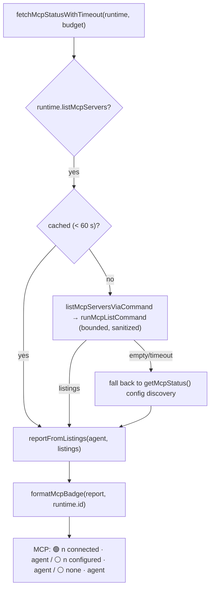

- **Honest mapping (`mapListingToServerState`).** Only `connected` maps to `connected`; `disabled` →
  `disconnected`; `enabled`/`pending`/`unknown` → `unknown` (configured, never probed). A listing word
  is never upgraded to liveness (AC-32.2).
- **Attribution.** `reportFromListings` ids every server `<agent>:<name>`, defaults a missing
  transport to `"unknown"` rather than assuming stdio, and flags `unverified` whenever nothing was
  probed. The badge (`formatMcpBadge(report, agentName)`) names its source; every numeric field is
  nullish-coalesced (`count()` / `mcpToolTotal()`), so `undefined`/`NaN` cannot render (AC-32.4 /
  NFR-10).
- **Never fabricate, never block.** `runMcpListCommand` reuses `runModelListCommand`'s bounded spawn
  (timeout, stdout cap, process-group kill, sanitized `reason`) and returns `{ error }` rather than
  throwing; `listMcpServersViaCommand` collapses that to `[]` so a missing binary or unparseable
  output silently degrades to config discovery instead of failing the poll.
- **Deeper truth where it exists (AC-32.5).** Whatever per-server detail the CLI exposed (command,
  scope, auth) travels on `detail` and is shown verbatim; where the agent reports no status the panel
  says so ("Status not reported by &lt;agent&gt; — configured, not probed").
- **Verification.** Each format is fixture-tested against captured output
  (`test/fixtures/*-mcp-list.txt`, documented in `test/fixtures/README.md`), the status mapping and
  badge strings have their own tests, and a guard drives every badge state asserting the literal
  `undefined`/`NaN` never appears.

### 27.2 Interactive runtime picker (REQ-33)

`src/tui/AgentPickerModal.tsx` turns runtime switching into a selection. `/agent` (no argument) opens
it; `/agent <id>` is unchanged. The modal renders `AGENT_TARGETS` in registry order via
`buildAgentRows`, resolving availability from `detectAvailableAgents()` asynchronously (a detection
failure simply leaves every row "not installed", never blocks render). Each row shows the label, a
`✔` or `— not installed`, a `● active` marker for the current runtime, and — for the highlighted row
only — its resolved binary path; the list is windowed (`VISIBLE_AGENT_ROWS = 6`) with
`▲`/`▼` overflow markers. `↑`/`↓` (or `j`/`k`) move, `Enter` calls `onSelect` and `Esc` cancels; the
caller (`LiveDashboard`) keeps the modal open when a switch fails, so another runtime can be chosen
immediately, and its footer reminds the user that Muninn memory is project-scoped and unaffected.

### 27.3 Composer ergonomics & honest panels (REQ-34 / REQ-35)

- **Input history.** `LiveDashboard` keeps a bounded `inputHistory` (`INPUT_HISTORY_LIMIT = 50`); `↑`
  recalls the previous submission when the palette is closed, the draft is empty and the chat card is
  focused, and `↓` walks forward ending at the empty draft. Recalled drafts stay editable, and
  slash-command submissions are excluded from history.
- **Composer presence (AC-34.2).** `ChatInputRow` owns its accent border/background and a `❯` glyph,
  and reserves exactly one content line regardless of placeholder or history hint, so the layout
  budget at 80×24 is unchanged.
- **Honest panels.** The `REFINEMENT CONVERSATION` card is renamed **`Conversation`** wherever
  rendered or documented (AC-35.1). The agent-stream panel is adaptive (AC-35.2): it renders
  collapsed — returning its rows to the conversation — until the session has real stream content, and
  expands on the first content; it is never an empty bordered box.
- **Target hygiene (AC-35.3, ADR-34).** `gemini` is removed from `AGENT_TARGETS`/`AGENT_REGISTRY`. The
  persisted-config path stays safe: `REMOVED_AGENT_TARGETS` (`gemini → agy`) makes `resolveAgent`
  warn and fall back to detection instead of throwing, and any *other* unknown value is still rejected.

### 27.4 Methodology profiles — the Huginn Cycle + SDD/ODD/RDD/Strict-TDD (REQ-36)

The pipeline was already data (`PipelineStep[]`), so a profile is a **named, ordered subset of the
existing phase vocabulary** plus the evidence it must freeze — `runPhase`/`runIteration` are
untouched. `src/engine/profiles.ts` defines `PROFILES: Record<ProfileName, ProfileSpec>`
(`ProfileName = "huginn"|"sdd"|"odd"|"rdd"|"strict-tdd"`, `DEFAULT_PROFILE = "huginn"`, i.e. the
**Huginn Cycle**), each with `phases`, an `evidence` rule (`none`/`receipt`/`snapshot`), and an
optional `preamble` folded into the iteration prompt:

| profile | phases | evidence |
|---|---|---|
| `huginn` | SPEC_AUDIT → EXECUTE → VALIDATE_STEP → TEST_MODULE → VERIFY → SECURE_CHECK → REVIEW → DOC_SYNC → COMMIT_ALL | none |
| `sdd` | SPEC_AUDIT → EXECUTE → VALIDATE_STEP → TEST_MODULE → REVIEW → DOC_SYNC → VERIFY → COMMIT_ALL (+ spec-first preamble) | receipt |
| `odd` | EXECUTE → TEST_MODULE → VERIFY → COMMIT_ALL | none |
| `rdd` | EXECUTE → TEST_MODULE → VALIDATE_STEP → VERIFY → COMMIT_ALL | receipt |
| `strict-tdd` | TEST_MODULE → EXECUTE → TEST_MODULE → VALIDATE_STEP → VERIFY → COMMIT_ALL | snapshot |

- **Surface.** `--profile <id>` on `run` and `live`, `profile` in `RunConfig`/`UserConfig`/
  `stateSchema` (sanitized like `mode`), and `huginn config set --profile`. `resolveProfile` fails
  closed with usage on an unknown flag; a persisted unknown profile is dropped with a warning.
- **Profile-aware lists.** `--only-phase` validates against `PROFILE_PHASES` (the union over all
  profiles), and `MAIN_PHASES`-derived progress/`PHASE_LABEL` render from the active profile.
- **Two subtleties the gate forced.** The resume cursor is occurrence-aware (keyed off the first step
  the iteration has *not* recorded, not `currentPhase` which starts at SPEC_AUDIT), so a profile that
  does not begin with SPEC_AUDIT no longer runs zero phases and reports success; and `strict-tdd`'s
  pre-EXECUTE `TEST_MODULE` (`testFirst: true`) is **judged but never blocks or triggers `FIX_TEST`**,
  so the failing test is recorded as evidence rather than "fixed" into an inverted TDD.
- **Frozen evidence (`src/engine/receipts.ts`).** For `rdd`/`strict-tdd`, `buildIterationReceipt`
  produces an `IterationReceipt` (profile, base/head commits, `treeHash`, verdicts, and for
  `strict-tdd` the `preExecuteTree`) and `writeIterationReceipt` persists it to
  `.huginn/receipts/iter-<n>.json` (`0o600`) — best-effort, so a receipt can never fail an otherwise
  successful iteration. The claim "tests passed" is checkable against a hash instead of prose.
- **Announced & fail-closed.** The active profile is printed in the CLI banner (`profile=huginn`) and
  shown as the **Methodology** row in `/status`; `validateProfilePhases` rejects a profile naming an
  unimplemented phase rather than silently degrading to the default.

### 27.5 Agent-agnostic question protocol (REQ-37)

Only opencode could surface a mid-turn question (and only with `permissions: ask` through its own
event stream); every subprocess CLI closes `stdin` after the prompt. `src/engine/questionBlock.ts`
defines a **marked block** that needs no protocol support from the CLI:

```
<<<HUGINN_QUESTION>>>
[{"question": "Which database?", "header": "Storage",
  "options": [{"label": "Postgres", "description": "managed"},
              {"label": "SQLite", "description": "embedded"}]}]
<<<END_HUGINN_QUESTION>>>
```

```mermaid
sequenceDiagram
    participant Agent as Any runtime (subprocess or opencode)
    participant Live as LiveEngine.chat()
    participant Parser as parseQuestionBlock()
    participant UI as DecisionModal
    Agent->>Live: reply text + marked block
    Live->>Parser: parseQuestionBlock(reply)
    Parser-->>Live: { questions, cleanedText }
    Live->>Live: emit cleanedText (block stripped)
    alt questions present
        Live->>UI: DecisionRequest { kind: "question", questionItems }
        UI-->>Live: digit → option label / Enter → recommended / d → skip / Esc → abort
        Live->>Agent: follow-up turn (formatQuestionAnswer)
    end
```

- **Parsing.** `parseQuestionBlock` returns `{ questions, cleanedText, warning? }`. It strips **every**
  block from the displayed text (so a second block cannot leak raw markers), bounds the payload
  (64 KiB), the question count (10) and the options (8), sanitizes every field, and — for an
  unparseable, oversized, unclosed or options-less block — returns a sanitized `warning` **without
  truncating the rest of the reply**. `normalizeQuestion` keeps `multiple`/`custom` flags if present.
- **Wiring.** `LiveEngine.chat()` parses the reply, emits any warning to the system log, strips the
  block, and when questions exist raises a `kind: "question"` `DecisionRequest` through the decision
  broker **once per question**; `askQuestions` collects one answer per question and the chosen
  answers are sent back as a plain follow-up turn (`formatQuestionAnswer`) so it works on every
  runtime. `askQuestion` bounds each wait (`QUESTION_TIMEOUT_MS = 10 min`, `.unref()`'d) and aborts the
  turn on expiry rather than hanging. opencode's native `question.asked` / `permission.asked` path is
  untouched and produces the same `DecisionRequest`.
- **Decision UI.** `DecisionModal` (and `LiveDashboard.resolveDecisionKey`) render one row per option
  with its description, inline (a `<Box>` column, not a `<Box>` inside a `<Text>` — Ink would not draw
  it), and the modal is `flexShrink: 0` so the fixed-height frame gives up conversation rows instead
  of clipping options. A paged block shows a `(i/n)` counter in the title. A digit `1`–`9` picks that
  option verbatim, `Enter` accepts the recommended (first) one, `d` skips and `Esc` aborts; keys are
  matched explicitly, so the `input === ""` that Ink sends for non-alphanumeric keys (Escape included)
  can no longer silently answer. When a block arrives whole through opencode's native channel, only
  the first question is selectable — the remaining questions and their options stay visible.
- **Deliberately de-scoped (AC-37.3).** `multiple` (multi-select) and `custom` (free-text) are parsed
  but honoured nowhere, and there is no arrow-key selection; a future iteration must amend the AC
  before claiming them, rather than assume them.
- **Taught to the agent.** The protocol is injected into the refine system prompt and the Muninn rules
  block (`integrator.ts`), so any agent can be told how to ask.

### 27.6 Muninn provisioning & agent-independent memory (REQ-38)

Memory is Huginn's differentiator, so it must not belong to any agent. The database stays
**project-scoped** (`<project>/.huginn/muninn.db`, ADR-20); the engine never keys memory by
`runtime.id`, so switching runtime mid-session reads and writes the *same* brain (asserted by a test
that observes identical stats across a switch).

`huginn setup` gains a provisioning surface built on `describeMuninnProvisioning` (a
`MuninnProvisioningRow[]` of agent × installed × registered, with the inspected paths):

- **`--status`** prints the matrix (`✔ registered` / `• not registered`, `installed` / `not installed`)
  plus the exact fix command for the installed gaps (`huginn setup --agent <id1,id2>`), and writes
  nothing. `huginn doctor` renders the same rows in its `integrations` check.
- **`--agent a,b`** selects exactly that subset (comma-separated; `all` is the default); an unknown
  name — alone or in a list — exits non-zero with usage.
- **`--installed`** *filters* the selection to agents whose CLI is present and reports the skipped
  ones; it never widens the selection.
- **`--dry-run`** computes the identical report and writes **nothing**: `writeAtomic` returns early
  while still reporting what would be registered, skipped as conflicting, and which rules files would
  change.
- **One registration mechanism (AC-38.3, verified).** A native-first path (`opencode/claude/qwen/agy/
  commandcode mcp add`) was evaluated and rejected — `opencode mcp add` takes no command positional
  (it prompts interactively) and `commandcode mcp add` accepts only `url`, so shelling out would need
  per-CLI special cases for strictly less safety than the hardened file writer the agents already
  read. Provisioning keeps the single `registerMcpForTarget` (atomic, symlink-safe, key- and
  sibling-preserving, `0o600`); an existing registration is a no-op and an unparseable config is
  reported, never rewritten.

## 28. Phase 8 — Huginn-owned cycle, git bootstrap, per-runtime permissions & runtime lineup

Phase 8 removes the last dependencies the cycle had on *things outside the binary* and makes the
runtime support honest. Verified facts behind it: `run`/`plan`/`live` refused to start in any
directory that was not already a git repository; the cycle delegated its gates to slash commands and
subagents that had to be copied into `~/.config/opencode` (and that a subprocess runtime could not
resolve at all); a subprocess runtime had no way to answer a permission prompt, so
`--permissions ask|deny` silently ran it fully auto-approved; and the runtime registry had drifted
from the CLIs that exist. The implementation lives in `src/engine/steps/` (new),
`src/engine/gitRepo.ts` (new), `src/engine/phases.ts`, `src/engine/cycle.ts`, `src/engine/diff.ts`,
`src/engine/agent/registry.ts` + `src/engine/agent/adapters/`, `src/util/docPath.ts` (new),
`src/util/prompt.ts` and `src/commands/install.ts`. The phase *engine* (`runPhase`/`runIteration`),
the pipeline-as-data model, the worktree sandboxing model and the Muninn schema are untouched.

### 28.1 Git bootstrap instead of a repository prerequisite (REQ-39)

The prerequisite was not only strict, it was *wrong*: `existsSync(<project>/.git)` reports "not a
repository" for a subdirectory, a linked worktree and a symlinked checkout — all of which are inside
a work tree — while a bare repository and `.git` itself answer `false` with exit 0. A boolean cannot
tell those apart, and the dangerous question is which failure may be answered with `git init`: a
dubious-ownership or permission error must never be read as "this directory is safe to initialize".

```mermaid
flowchart TD
    A["work command (run / plan / live)"] --> B["probeGitRepo(projectPath)"]
    B --> C["git rev-parse --is-inside-work-tree"]
    C -- "stdout true" --> D["work-tree → continue"]
    C -- "stdout false, or git's 'not a git repository'" --> E{"--no-git-init?"}
    C -- "any other failure" --> F["error → print reason, exit 1 (no mutation)"]
    E -- yes --> G["<path> is not a git repository → exit 1"]
    E -- no --> H["ensureGitRepository(): init -b main, .gitignore, identity, bootstrap commit"]
    H --> I["re-probe → work-tree → continue"]
```

- **The tri-state** (`probeGitRepo` / `gitRepoState` / `isGitRepo`, `src/engine/diff.ts`) is
  `work-tree | not-a-repo | error`, with git's own message kept as `detail`.
- **The bootstrap** (`ensureGitRepository`, `src/engine/gitRepo.ts`) runs `git init -b main`, writes
  `GITIGNORE_PATTERNS` (`node_modules/`, `dist/`, `build/`, `.harness/`, `.huginn/`, `*.log`,
  `coverage/`, `.DS_Store`, `.env`) only when the name is free, fills in a committable identity
  (`user.email`/`user.name`, treating an **empty** answer as missing, written `--local` so the user's
  global config is never touched) and creates the commit `chore: initialize repository`. The engine
  now always has a `HEAD` to diff against — which is also what makes `createSandbox` viable on a
  greenfield project.
- **Two hardening details worth keeping.** The `.gitignore` write is `lstat`-guarded (never following
  the final component) and then created with the exclusive `wx` flag at `0o600`, so a repository (or
  a directory about to become one) shipping a *dangling* `.gitignore -> ~/.bashrc` cannot make
  onboarding write outside the project. And the bootstrap commit uses `--no-gpg-sign` rather than
  `-c commit.gpgsign=false`, because `-c` is a forbidden argument to the hardened `git()` screen
  (§ 28.6) — one invocation must not need an exemption the screen exists to close.
- **`--no-git-init`** keeps the previous behavior for callers that must not be mutated, and
  `huginn init` reports the same state through `isGitRepo()` while staying informational (it prints a
  `git init` tip and never initializes).

### 28.2 The cycle owns its step instructions (REQ-40 / REQ-41)

The prompt composition is what makes a subprocess runtime a first-class citizen, so it is the single
seam every phase goes through:

```mermaid
flowchart LR
    A["phase fn (phases.ts)"] --> B["composer (engine/steps/prompts.ts)"]
    B --> C["role + task literal (engine/steps/instructions.ts)"]
    B --> D["bounded context (engine/steps/context.ts)"]
    D --> E["embedUntrusted / embedFile — sanitized, bounded, nonce-delimited"]
    B --> F["resolveShellInterpolations — git subcommand allowlist"]
    C --> G["promptWithContext → IAgentSession.prompt(text, { agent?, model, directory })"]
    E --> G
    F --> G
    H["huginn install"] --> I["handleInstallCommand(): no-op notice, exit 0"]
```

- `promptWithContext` is the only path a step takes, and the only `agent` it ever names is opencode's
  built-in `build` (`EXECUTE` and the `FIX_*` phases), so a subprocess runtime receives the same text
  as a plain prompt and opencode's session keeps the build agent's tools. Nothing calls `runCommand`
  any more, which is why the same phases (including the deterministic `VERIFY`) run on every runtime.
- `validateStep` is huginn-orchestrated: qa (`auditOnlyGuardrails()` → `AUDIT-ONLY MODE`, run the
  suite once non-interactively, write no artefact), spec-auditor, security, then a synthesis turn
  that receives the three reports. The sub-prompts demand the deterministic final lines
  (`### Audit status:` for qa/security, `### Overall fidelity:` for the spec auditor) and the
  synthesis emits the consolidated report.
- There is nothing to install: `templates/{agents,commands}/`, `scripts/postinstall.ts`,
  `src/setup/install.ts`, the `postinstall` script and `HUGINN_TEMPLATES_DIR` are gone, and
  `huginn install` is a no-op handler (`src/commands/install.ts`) kept only because `install` is a
  routed subcommand. The two primitives the installer owned moved: `promptLine`/`promptYesNo` (with
  the `PromptIo` seam) to `src/util/prompt.ts`, `getOpencodeConfigDir` to
  `src/setup/opencodeConfig.ts`.

### 28.3 Deterministic verdicts and the read-only audit guard (REQ-40)

Once huginn generates the `VALIDATE_STEP` report itself, letting the gate read that report would make
the verdict the model's again — and nothing enforced that an auditor phase is read-only.

```mermaid
flowchart TD
    subgraph phase["VALIDATE_STEP"]
        A["qa (AUDIT-ONLY)"] --> B["spec-auditor"] --> C["security"] --> D["synthesis"]
    end
    A -- "### Audit status:" --> V["computeValidateVerdict(reports, synthesis)"]
    B -- "### Overall fidelity:" --> V
    C -- "### Audit status:" --> V
    D -- "canonical '### Overall gate:' line" --> V
    V --> W["enforceValidateVerdict(text, verdict)"]
    V --> X["authoritativeVerdict on the PhaseOutput"]
    X --> Y["resolveStructuralVerdict → runPhase gates on the field"]
    Z["treeHash before"] --> T["readOnlyTreeViolation(before, after)"]
    T -- "missing/changed" --> U["verdict forced to blocked"]
```

- **The sub-report verdict is fail-closed and deterministic**: an empty or marker-less report is
  `blocked`, any blocked → `blocked`, any warning → `warning`, all green → `pass`
  (`computeSubReportVerdict`). The synthesis is advisory: only its *canonical* `### Overall gate:`
  line is read (`parseCanonicalGateLineVerdict`) and it may only escalate the result — reading any
  emoji in the body would turn a model echoing its own template into a spurious BLOCKED.
- **The report and the verdict are reconciled**: `enforceValidateVerdict` strips every pre-existing
  gate/handoff line and appends huginn's own, so `parseValidateStepVerdict` (unchanged) reads back
  exactly what huginn computed; the effective verdict also travels structurally as
  `authoritativeVerdict`, and `runPhase` prefers it over the text (`resolveStructuralVerdict`).
- **Read-only is enforced, not assumed**: `SPEC_AUDIT`, `VALIDATE_STEP`, `SECURE_CHECK` and `REVIEW`
  carry `readOnly: true` in the pipeline; the engine hashes the working tree before and after the
  step and forces `blocked` when the signature is **missing** as well as when it changed
  (`readOnlyTreeViolation`) — a hash that cannot be taken is not evidence of a clean step.
- The compiler-contract check short-circuits the gate before any model call when it finds a
  violation **or cannot run** (`verifyContractsOrFail`, fail-closed — the gate is never silently
  degraded to an agent-judged pass).

### 28.4 Per-runtime permission auto-approval (REQ-42)

| runtime | auto-approval flag | note |
|---|---|---|
| `claude` | `--dangerously-skip-permissions` | |
| `codex` | `--dangerously-bypass-approvals-and-sandbox` | |
| `qwen` | `-y` | |
| `omp` | `--auto-approve` | |
| `commandcode` | `--yolo` | |
| `devin` | `--permission-mode dangerous` | carried over from the `windsurf` target |
| `agy` | `--dangerously-skip-permissions` | |
| `mcode` | `--permission full` | the `smart` default still decides per action |
| `mimo` | `--yolo` | `run`'s own switch; its global `--trust`/`--never-ask` are rejected by `run` |
| `cursor` | `-f` | |
| `pi` | `--approve` | announced as *assumed*: project-resource trust, not tool auto-approval |
| `kimi` | *(none)* | prompt mode rejects every permission switch and forces its own auto mode |
| `opencode` | *(not applicable)* | permissions are enforced through the event subscriber |

`SUBPROCESS_PERMISSION_ARGS` (`src/engine/agent/registry.ts`) is the table every runtime reads. The
dedicated adapters export the same array *instance* next to their argv (`PI_PERMISSION_ARGS`,
`CLAUDE_PERMISSION_ARGS`, `CODEX_PERMISSION_ARGS`), and after M4b the CLI-only rows live in
`src/engine/agent/genericTargets.ts` and are the same instances `GENERIC_TARGET_SPECS` uses, so the
documented table and the spawned argv cannot drift. Fail-closed behavior:
`assertPermissionModeSupported(runtime.id, permissions)` (`src/cli.ts`) exits 1 before anything runs
when `ask`/`deny` meets a non-opencode runtime, `LiveEngine.switchRuntime` refuses the same
combination with the same wording (`subprocessPermissionMessage`), and an invalid `--permissions`
value (`denn`) exits 1 instead of falling back to `auto`.

### 28.5 Runtime lineup (REQ-43 / M4b)

| runtime | served target(s) | binary(ies) | model discovery | MCP enumeration |
|---|---|---|---|---|
| `pi` | `pi` | `pi` | `pi --list-models` | none → config discovery |
| `opencode` | `opencode` | `opencode` | SDK `provider.list().connected` + `opencode models` fallback | `opencode mcp list` |
| `codex` | `codex` | `codex` | none → `[]` with a reason | `codex mcp list --json` |
| `claude` | `claude` | `claude` | none → `[]` with a reason | `claude mcp list` (health-checks) |
| `generic` | `cursor`, `agy`, `commandcode`, `devin`, `kimi`, `mcode`, `mimo`, `omp`, `qwen` | per target (see `GENERIC_TARGET_SPECS`) | none → `[]` with a reason (the per-CLI parsers were removed in M4b) | none → config discovery |

`AGENT_BINARIES` still declares the primary and fallback names for all 13 provisioning targets, and
`detectAvailableAgents`/`resolveAgent` scan them in `AGENT_TARGETS` order. The eight CLI-only
targets are no longer separate runtimes but stay in the registry, so `huginn setup --status` keeps
listing 13; a persisted value naming one of them warns and falls through to detection instead of
throwing (any *other* unknown value is still rejected, so a hostile config cannot name an arbitrary
binary). `--agent <target>` remains the explicit escape hatch and runs the target through
`generic`.

### 28.6 Repository material is untrusted (REQ-40 / hardening)

| surface | hazard | contained by |
|---|---|---|
| any embedded fragment (docs, git output, module names, reports, transcript) | repository text read as instructions; unbounded size | `embedUntrusted` — sanitized, fence-neutralised, `<<<BEGIN/END UNTRUSTED-<nonce> …>>>`, capped at `MAX_EMBEDDED_OUTPUT` = 60 000 chars with a truncation marker |
| a `!`git …`` interpolation inside a task body | arbitrary command execution through a prompt | `resolveShellInterpolations` — subcommand allowlist (`diff`, `log`, `status`, `ls-files`, `show`), write/exec flags rejected, only `head`/`sort` pipes |
| document paths (`spec.md`, `adr.md`, `plan.md`, embedded files) | symlinked read (exfiltration into a prompt) or write (clobbering the link target) | `src/util/docPath.ts` — a symlinked final component is always refused; inside the project the `realpath`ed path must stay inside the `realpath`ed root; a missing tail is decided on its nearest existing ancestor; an explicit out-of-project path keeps working, symlink-screened |
| every git invocation | `core.pager`/`core.fsmonitor`/`core.hooksPath`, `diff.external`, a `.gitattributes` textconv driver, or a later `--ext-diff`/`--textconv` argument executing a repository-chosen program | `git()` — global `--no-pager -c core.pager=cat -c core.fsmonitor=false -c core.hooksPath=/dev/null`; `--no-ext-diff --no-textconv` inserted after the subcommand **and** at the end of the option argv (last-one-wins), plus a subcommand allowlist and the `FORBIDDEN_GIT_ARG` screen (`-c`, `--output`, `--exec-path`, `--upload-pack`, `--config-env`, `--git-dir`, `--work-tree`, `--no-index`, `--ext-diff`, `--textconv`, `-O`) for the bounded runner |
| the live-session store | a hostile id echoed into a terminal or sent back to the opencode server | `LIVE_ID_PATTERN` validation plus `sanitizeTerminalText` on every identity field, in and out (§ 29.2) |

## 29. Phase 8 — Live context, persisted sessions & resume

The refinement conversation used to live only in `LiveEngine.messages`, so closing huginn lost it and
the handoff to the cycle (`resetHarnessState`, which clears `.harness/`) blanked it. The other half
of the problem was an assumption: opencode keeps the conversation server-side, every subprocess
runtime does not, and a resumed or long session therefore saw no history at all. The implementation
lives in `src/state/liveSession.ts` (new), `src/engine/liveMode.ts`, `src/server/client.ts`
(`probeSession`), `src/cli.ts` (flags + listing) and `src/tui/LiveDashboard.tsx` (rehydration).

### 29.1 Runtime session history and bounded transcript replay

`IAgentRuntime.sessionHistory?: boolean` declares whether the backend keeps the conversation:
`true` for opencode only, `false` for every subprocess adapter, and `undefined` is read as
"does not keep history" — so context is re-sent rather than silently dropped.

For a history-less runtime each turn carries `formatTranscript(messages)`: at most
`TRANSCRIPT_MAX_TURNS` = 12 turns / 12 000 characters, newest last, with an explicit omission marker,
each line `USER:`/`ASSISTANT:` sanitized, and the **current ask is never part of it**. The block is
wrapped by `wrapUntrustedTranscript` in a `<<<BEGIN/END UNTRUSTED TRANSCRIPT-<nonce>>>` block whose
nonce is fresh per prompt. A session that was successfully reattached to its server-side id
suppresses the replay (`reattached`) instead of sending the conversation twice.

### 29.2 The persisted store (`<project>/.huginn/live/sessions.json`)

```mermaid
flowchart TD
    A["LiveEngine.messages"] --> B["upsertLiveSession(projectPath, session)"]
    B --> C["sessions.json.tmp (exclusive, 0o600)"]
    C --> D["renameSync → sessions.json"]
    E["resume"] --> F["loadLiveSessions / getLiveSession / listLiveSessions"]
    F --> G["sanitized LiveSession[] ([] + warning on any failure)"]
    H["liveDir(projectPath)"] --> I["lstat every component → refuse a symlink; realpath(dir) must stay under realpath(projectPath); reopen O_DIRECTORY|O_NOFOLLOW"]
```

- **Location**: deliberately outside `.harness/` (the handoff clears it) and under `.huginn/`, whose
  `.gitignore` is written `*`, so the state never dirties the working tree and the git-derived prompt
  context stays clean.
- **Atomicity and containment**: an exclusive temp file in the same directory is written `0o600` and
  `renameSync`ed into place; every path component is `lstat`ed (a symlink is always refused) and
  `realpath(liveDir)` must stay inside `realpath(projectPath)`; only directory levels this process
  created are `chmod`ed `0o700`, and the directory is re-opened `O_DIRECTORY|O_NOFOLLOW` before a
  write.
- **Caps** (`MAX_LIVE_MESSAGES` = 200, `MAX_LIVE_SESSIONS` = 20, `MAX_LIVE_MESSAGE_CHARS` = 20 000
  with a `…[truncated]` marker, `MAX_LIVE_STORE_BYTES` = 8 MB) are enforced on the **write** path as
  well as on read — the per-message and per-session caps alone allow a store several times over the
  byte cap, and a file the reader refuses would make the next save drop everything it can no longer
  see. Shrinking announces what it drops.
- **Fail-open reads**: a missing, unreadable, oversized, malformed or linked file yields `[]` (or
  `undefined`) plus a warning on the engine log channel, so a damaged store is visible instead of
  indistinguishable from "this project never ran live".
- **Sanitized identities**: `id`, `runtimeId`, `projectPath`, `createdAt`, `updatedAt`,
  `opencodeSessionId`, the title and every message text are terminal-sanitized in and out, and an id
  that does not match `LIVE_ID_PATTERN` (`[A-Za-z0-9._:-]{1,128}` with at least one alphanumeric)
  drops the whole session — the id is also sent back to the opencode server by the reattach probe.
- **Deliberate residual**: two processes writing the store are serialized only by the atomic rename
  (last writer wins; there is no cross-process lock), and containment is decided on the directory
  *name* rather than held open as an `O_DIRECTORY` fd across the write.

### 29.3 Resume flags, listing and reattach

- **A plain `huginn live` always starts a new session.** Resume is explicit:
  `--session <id>` (strongest) → `--continue`/`-c` (the project's most recently updated session,
  saying so and starting fresh when there is none). A bare `--session` with no id exits 1 rather
  than silently resuming nothing.
- **`--list-sessions` / `-sl` is a report, not a run**: it prints id, `updatedAt`, runtime id, message
  count and title (newest first) and exits 0 **before** permissions, the git bootstrap, the agent
  runtime or the TUI are touched, so listing can never initialize a repository, spawn an agent or
  start a cycle. The store's own warnings (which never change the exit code) are drained from the log
  channel and printed to stderr; the project path is sanitized because this output is a terminal
  sink.
- **Reattach**: a resumed conversation probes its stored `opencodeSessionId` through the client.
  `probeSession` keeps `exists` / `gone` / `failed` distinct so the outcome can be *reported* rather
  than guessed; only a confirmed `exists` reattaches (and suppresses the transcript replay), anything
  else replays the transcript and says so.

### 29.4 Rehydration after the handoff

The handoff reset clears `.harness/` only. The conversation therefore survives the cycle, and after
it the live view is **rehydrated from the engine** (`LiveEngine.messages` is the view's source), so
the refinement continues where it left off instead of rendering an empty card.

## 30. Phase 8 — Onboarding model picker (REQ-45)

`huginn init` used to ask for thinker/executor as free text while `ModelPickerModal` already
discovered what the runtime can run (ADR-27) — two selection paths over the same runtime, one of them
blind. Step 4 now goes through the same helper the modal uses:

```mermaid
flowchart TD
    A["init step 4 (src/commands/init.ts)"] --> B["discoverModelCatalog(runtime) (engine/agent/modelCatalog.ts)"]
    B -- "getModelCatalog() present" --> C["{ models, reason? }"]
    B -- "legacy runtime" --> D["getAvailableModels()"]
    C --> E{"catalog non-empty?"}
    E -- yes --> F["numbered picker of provider/model ids (+ description)"]
    E -- no --> G["plain text entry + sanitized reason"]
    F --> H["entry value: current id as-is; an explicit flag the catalog omits verbatim; else catalog seed (thinker → first, executor → second)"]
```

- **Preselection rules** (`promptModelChoice`): a real catalog id is used as-is — whether
  pre-selected or typed directly into the numbered prompt (a typed id is matched against the catalog
  ids, not just the display labels); an explicit `--thinker`/`--executor` the catalog does not list is
  kept **verbatim**, so pressing Enter never silently overrides what the user typed; a *default* absent
  from the catalog seeds from the catalog (thinker → first model, executor → second) so the two
  pickers do not land on the same model.
- **A typed answer is never dropped on the floor**: `promptChoiceDefault` returns an explicit answer
  that is not a 1-based list number verbatim (only a blank answer keeps the fallback), and each caller
  validates it — the agent prompt through `isAgentTarget`, the model prompt through its catalog id
  set. Previously an unlisted answer was silently replaced by the pre-selected seed, so a model id
  typed instead of its number persisted the wrong model.
- **Honest fallback**: with no catalog, or an empty one carrying a `reason`, the wizard falls back to
  plain text entry and prints the sanitized reason — a runtime that cannot list models is never a
  dead end, and the non-TTY/`--yes` path uses the same values.
- Sharing `discoverModelCatalog` is what keeps the wizard and the modal from drifting: one discovery
  contract, one error vocabulary.

## 31. Phase 8 — Composer, semantic theme & honest live surfaces (REQ-46 / REQ-47)

### 31.1 The composer is an editor (`src/tui/composer.ts`)

The message row was a single-line input: editing meant retyping and a long draft could not be written.
`composer.ts` is a small text model — caret position within the wrapped draft, insertion at the caret,
`←`/`→` by character (word-wise with `⌥`/Ctrl), `Backspace`/`Delete` at the caret,
`Home`/`End` at the ends of the caret's *visual* row, and `cursorLineParts` painting the `▏` glyph in
a free column (or over the character it covers when the row is full) so the caret never pushes a
column off the row. On a draft that wraps, `↑`/`↓` move the caret between the composer's own visual
rows (`cursorIndexAtRow`); on a single-row draft the key is swallowed, so the terminal still never
scrolls. The draft soft-wraps up to `MAX_INPUT_ROWS` = 6 visible rows and then scrolls internally
(`composerScroll`), so the layout budget is one content line until the draft actually wraps.

### 31.2 Semantic theme tokens (`src/tui/theme.ts`)

| aspect | behaviour |
|---|---|
| tokens | `text`, `muted`, `border`, `borderFocus`, `accent`, `accentStrong`, `ok`, `warn`, `danger`, `info`, `thinker`, `executor`, `system`, `brand` |
| `text` | `undefined` — Ink emits no foreground escape, so the body inherits the terminal's own foreground (the only always-legible value) |
| modes | `light`, `dark`, `auto` (default, memoised on the raw environment); `auto` sniffs `COLORFGBG` when the terminal advertises it and otherwise stays background-agnostic |
| override | `HUGINN_THEME` (`light`\|`dark`\|`auto`) |
| `NO_COLOR` | any non-empty value clears every token **and** gates `dimColor` (chalk does not consult `NO_COLOR` itself) |
| retired | hard-coded chalk colour names, including the `color="white"` chat body that was invisible on a white terminal; `muted` is a real colour (`gray`), not `dimColor` |

Components ask for a role, never a colour, so the whole view moves together and a guardian test can
forbid the washed-out colour families by name.

### 31.3 Live context panel, empty-state hero and non-fabricated summaries

- **`InfoPanel.tsx` — the LIVE CONTEXT column.** Rendered only when the terminal is wide enough:
  `SIDE_PANEL_MIN_COLUMNS` = 100, `SIDE_PANEL_MIN_ROWS` = 8 spare rows, and enough width left for the
  cards (`SIDE_PANEL_MIN_CARD_COLUMNS` = 44) after `SIDE_PANEL_WIDTH` = 34 columns plus a 1-column
  gap. It shows the stage, agent + models, the per-agent MCP enumeration, the git branch/tree state,
  the worktree sandbox, Muninn's counts, the size of the conversation and one stage-appropriate tip
  (`PANEL_TIP_PREFIX`). It lives inside the region the cards already own, so it can never push the
  composer, palette or footer off the frame; below the thresholds the header alone carries the facts.
- **`LiveHero.tsx` — the empty-state hero.** When the conversation is empty the card renders the raven
  brand (`buildRavenArtRows`, the same art as `RavenHeader`) plus the console's first-run hints
  (`EMPTY_CHAT_HINTS`), sliced to the rows the card really has — an empty session guides instead of
  looking like a dead console.
- **`sessionContext.ts` — one vocabulary, no fabrication.** The header's second row and the panel
  derive their strings from pure functions, so they cannot disagree. Two rules: a counter with
  nothing to count renders `""` (never `0`), an unreadable Muninn database reports its sanitized
  error instead of looking empty, and the summaries carry no colour — the TUI picks the token, which
  is what keeps `NO_COLOR` a presentation concern.

## 32. Phase 8 — Run integrity, honest surfaces & a coherent terminal language (REQ-49…REQ-54)

This sub-phase answers four things a real run exposed: a finished iteration whose sandbox could not be
merged was *stranded* and reported as an abort; a Muninn command whose `--project` disagreed with its
working directory wrote into the wrong database; the run dashboard's output panel stayed at
`(waiting for agent stream / tool executions...)` for the whole run on every subprocess runtime; and the
phase grid was drawn with double-width emoji that broke the monospace grid. The implementation lives in
`src/engine/worktree.ts`, `src/engine/cycle.ts`, `src/state/schema.ts`, `src/state/store.ts`,
`@dahch/muninn`'s db client and memory service, `src/commands/doctor.ts`,
`src/tui/glyphs.ts` (new), `src/tui/Dashboard.tsx`, `src/tui/ProfilePickerModal.tsx` (new),
`src/tui/feedback.ts`, `src/brand.ts`, `src/engine/agent/types.ts` and `src/cli.ts`. The phase *engine*
(`runPhase`/`runIteration`), the pipeline-as-data model, the sandbox *model* and the Muninn schema are
untouched.

### 32.1 Promotion integrity (REQ-49 / ADR-48)

The parking, preservation and honest-outcome flows are part of the sandbox lifecycle and documented
there; the pieces that live outside `worktree.ts`:

- **`stateSchema.promotion`** (`src/state/schema.ts`) is an *optional*
  `{ status: "promoted" | "none" | "conflict" | "failed", branch, backups?, detail? }`, so state files
  written before this sub-phase still parse. The engine records it on every iteration (reset per
  iteration) and persists it with the failure.
- **`renderProgressMarkdown`** (`src/state/store.ts`) renders a failure as
  `✕ PROMOTION FAILED — branch \`<branch>\` preserved (local change(s) backed up under …)`, and keeps
  `✕ ABORTED` (`STATUS_GLYPHS.blocked`) for a genuine abort and `✓ COMPLETED` (`STATUS_GLYPHS.pass`)
  for success; every interpolated branch/backup path is `sanitizeTerminalText`ed.
- **Fail-closed but honest**: a promotion failure sets `outcome.reason = "error"` and finishes the run
  as an *error*, never as `aborted` (§ 19.4). Recovery is by hand (`git log <branch>`), and a re-run
  renames the branch out of the reclaim namespace instead of deleting it.

### 32.2 The run output panel is never dead (REQ-51 / ADR-50)

`StreamCard` in `src/tui/Dashboard.tsx` picks its body from what the engine actually has, in order:

1. **stream** — incremental `phaseStream` lines, available only when the runtime has an event channel
   (`src/engine/permissions.ts` forwards opencode's SSE stream);
2. **report** — the tail of `ui.lastReport.raw` (the last finished phase's real report), clipped to the
   card's rows, which is all a subprocess runtime ever produces;
3. **idle** — `TWO_RAVENS` (`src/brand.ts`, the Huginn + Muninn mark) plus a rotating phrase from
   `IDLE_AGENT_PHRASES`/`idleAgentPhrase` (`src/tui/feedback.ts`), and one honesty line naming the
   active runtime and stating that each phase's report appears when it ends.

A stream is only real when at least one line has non-whitespace content (the same rule as the live
view): a buffer that only holds `""` — a phase that emitted nothing — falls through to the report or
idle state instead of hiding it behind a blank row. The live view's collapsed-stream Tab hint is the
same rule applied to focus: no second card, no `[Tab] Focus` claim.

The capability comes from `IAgentRuntime.streamsOutput` (`src/engine/agent/types.ts`), not from a
hardcoded target list: `true` on `OpencodeRuntimeAdapter`, `false` on
`GenericSubprocessRuntimeAdapter` (and therefore on every adapter that inherits it), `undefined` read as
`false`. Only a streaming runtime keeps the `LIVE AGENT OUTPUT` title and the waiting placeholder; a
non-streaming one is titled `AGENT OUTPUT` and names itself. A failed promotion gets its own row under
the middle cards (`PROMOTION_HEIGHT`, `✕ PROMOTION FAILED — branch … preserved · backups: …`), shown
only when the run ends with `state.promotion.status` of `conflict`/`failed`, and the row is part of the
layout budget (`VIEWPORT_RESERVED_ROWS`) so it can never push the frame off-screen.

### 32.3 One semantic glyph table, single width (REQ-52 / ADR-51)

`src/tui/glyphs.ts` is the only place a phase/status glyph is defined:

| surface | glyphs |
|---|---|
| `STATUS_GLYPHS` | `pending` `·` · `running` the existing braille spinner (`⠋`) · `pass` `✓` · `warning` `!` · `blocked` `✕` · `skipped` `–` |
| `verdictGlyph(v)` | the status glyph for a `Verdict` (replaces `verdictIcon`'s emoji) |
| `phaseGlyph(phase)` | `SPEC_AUDIT` `?` · `EXECUTE` `>` · `VALIDATE_STEP` `=` · `TEST_MODULE` `%` · `VERIFY` `V` · `SECURE_CHECK` `#` · `REVIEW` `@` · `DOC_SYNC` `~` · `COMMIT_ALL` `.` · any `FIX_*`/unknown `+` |

- `verdictIcon` (`src/format.ts`) now delegates to `verdictGlyph`, so a colour token is still resolved
  by the TUI while the character comes from the table (AC-52.4).
- `.harness/PROGRESS.md` consumes the same table (`verdictGlyph` for the mark, `phaseGlyph` for the
  phase kind, `STATUS_GLYPHS.pending`/`running` for a pending row), so the markdown and the TUI cannot
  drift, and `PHASE_LABEL` in `src/state/store.ts` no longer carries an icon (AC-52.1).
- `Dashboard.tsx` drops its `⏳`, its hardcoded `🔴` fallback and `[⏸ PAUSED]` for
  `STATUS_GLYPHS.pending` / `STATUS_GLYPHS.blocked` / `[PAUSED]`; the modal section headers
  (`HelpModal`, `SkillsModal`, `ModelPickerModal`) lose their emoji.
- Out of scope deliberately: the gate marker literals (`### Overall gate: 🟢/🟡/🔴`, `### Overall
  fidelity: …`) and the stream-marker prefixes a *runtime* emits (`⚡ ✓ ✗ 💭`) — the first are a
  three-way contract, the second are producer output (AC-52.3).

### 32.4 Sessions are a documented surface (REQ-53 / ADR-52)

`usage()` (`src/cli.ts`) gains a **Sessions (live)** section: the store
(`<project>/.huginn/live/sessions.json`, owner-only, written atomically, never tracked by git), the
three flags, and the precedence — `--session <id>` is the strongest request and wins over `--continue`,
which adopts the project's most recently updated session; `--continue` with nothing to continue starts
fresh and says so; a bare `--session` fails closed. It also states the scope: sessions are a live-mode
surface, and `run` neither reads nor writes them. `usageCore()` adds a one-line pointer to it, and the
drift guard (`test/commands/init.test.ts`) asserts every token it advertises exists in `usage()`.

### 32.5 Methodology profiles are selectable in-session (REQ-54 / ADR-53)

The profile used to be fixed before the run and merely *displayed*. Now:

- **`LiveEngine.getProfile()` / `updateProfile(name, scope)`** (`src/engine/liveMode.ts`): the getter
  returns the resolved `{ id, name, description }`; the setter lowercases and validates against
  `PROFILE_NAMES`, **fails closed** with an actionable message on an unknown id (nothing is written),
  then persists through the existing writers — `session` keeps it in memory only, `project` writes
  `<project>/.huginn/config.json`, `global` writes `~/.huginn/config.json` — and mutates `cfg.profile`,
  so the header, `/status` and the next cycle all read the same value.
- **`/profile`** (registered in `src/tui/commandRegistry.ts`, so the palette and the `HelpModal` cheat
  sheet include it) opens `ProfilePickerModal`; `/profile <id>` applies directly. The modal mirrors
  `AgentPickerModal`: rows from `PROFILE_NAMES`/`PROFILES` with display name, description and an active
  marker, windowed at `VISIBLE_PROFILE_ROWS` = 6, `↑`/`↓`/`j`/`k` move, `Esc` cancels, and the scope
  keys are `Enter` = session, `p` = project, `g` = global.
- **No silent no-op (AC-54.4)**: the pipeline is chosen when a cycle starts, so the console states that
  a change applies to the **next** cycle, and the modal footer repeats it. While the picker is open it
  owns the row budget (the log tail steps aside, like the palette and the runtime picker).


